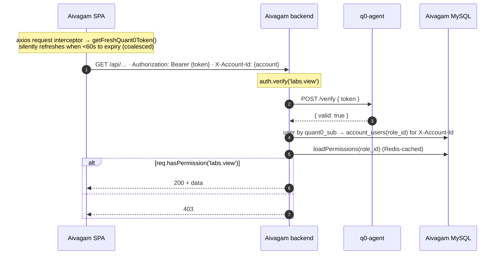

# Integrating quant0 as the Auth Provider for Aivagam — Hosted Redirect Edition

A step-by-step implementation guide with exact code changes. Written so that
someone who has never seen either codebase can follow it top to bottom.

**Revision:** 2026-07-28 · supersedes the embedded-SDK revision (2026-07-15).

> **Path convention.** Aivagam lives in three repos that are **siblings of this
> one**, not inside it. Paths written as `server/`, `client-react-web/` and
> `mission-control/` are relative to the parent directory that holds both
> checkouts:
>
> ```
> work/quant0/
> ├── quant0-enterprise/     ← this repo (platform + the server SDK)
> ├── quant0-client/         ← hosted portals (auth-portal, account-portal)
> ├── server/                ← Aivagam backend        (CommonJS Express)
> ├── client-react-web/      ← Aivagam SPA            (CRA + react-app-rewired)
> └── mission-control/       ← Aivagam staff console  (backend + its own SPA)
> ```
>
> Paths beginning `quant0-enterprise/` or `quant0-client/` are spelled out in
> full for the same reason. A shorter checklist of the same work lives beside
> this file in `aivagam-integration-checklist.md`.

---

## 0. What changed in this revision, and why

The previous revision of this document told you to embed quant0's **client**
SDK (`@quant0/react` + `@quant0/browser`) into the Aivagam SPA and render
`<SignIn>` / `<SignUp>` widgets inside Aivagam's own pages.

**That approach is abandoned.** It does not build inside Aivagam's frontend.
The two client packages ship raw TypeScript sources (`"exports": {".":
"./src/index.ts"}`, `private: true`, no build step), and Aivagam's client is a
JavaScript CRA app driven by `react-app-rewired` with no `tsconfig.json`.
Getting webpack to consume them was a chain of four separate failures — Babel
refusing to transpile TypeScript out of `node_modules`, unresolved
extensionless imports, `type: module` forcing webpack's `fullySpecified`
resolution, and finally "module has no exports" even after pre-building the
packages to `dist`. Every fix widened `config-overrides.js` and risked the rest
of the (very large) Aivagam bundle.

**The replacement is the hosted-redirect flow.** Aivagam's SPA carries **zero
`@quant0` npm packages**. Sign-in is a full-page browser redirect to quant0's
hosted **Login Portal**, and account self-service is a link to quant0's hosted
**Account Portal**. The OAuth 2.1 Authorization-Code + PKCE dance is ~200 lines
of plain browser API (`fetch`, Web Crypto, Web Storage) in one new file,
`src/app/quant0.js`. `config-overrides.js` is **not touched**.

The **backend** story is unchanged in shape and gets *more* important: Aivagam's
Express servers keep verifying tokens offline through a local **q0-agent**
sidecar using the **server** SDK `@quant0/sdk-core`. That package is allowed and
required. Only the *client* SDKs are out.

### Section-by-section delta from the previous revision

| Old § | Status | Replaced by |
|---|---|---|
| §1 Prerequisites (q0-agent) | kept, expanded | **§3** |
| §2 Phase 0 provisioning | kept, corrected | **§2** (adds the Account-Portal callback + CORS, which were missing and silently break "Manage account") |
| §3 Backend `server/` | kept, corrected | **§5** (adds 4 bug fixes found in live testing — see §5.9) |
| §4 Frontend `client-react-web/` | **deleted entirely** | **§6** — hosted redirect, no SDK, no provider, no widgets |
| §4.3 `Quant0Provider` + `AxiosAuthBridge` | **deleted** | §6.3 `installQuant0AxiosInterceptor()` |
| §4.5 `<SignIn>` widget | **deleted** | §6.5 `/signin` redirects to the hosted portal |
| §4.6 `<SignUp>` / magic-link / `handleFederatedCallback()` | **deleted** | §6.6 one `/callback` route handles every method (password, magic-link, Google, Facebook, SAML) because the portal owns all of them |
| §11.3 MC frontend (SDK) | **deleted** | **§7.3** — same hosted redirect |
| — | **new** | **§4** Publishing / installing `@quant0/sdk-core` (npm, private registry, local tarball, git) |
| — | **new** | **§1.4** CJS build of `@quant0/sdk-core` — a real code change in `quant0-enterprise`, **already applied** |
| — | **new** | **§6.8** Account Portal deep-link (two options) |
| — | **new** | **§9** Troubleshooting cookbook — every failure hit during live bring-up, with the root cause |
| §7 Permissions model (Model B) | **unchanged** | §8 |
| §10 Enterprise / MC provisioning | unchanged in substance | §7.5 |

### Repos involved

| Path | What it is | Language / build |
|---|---|---|
| `quant0-enterprise/` | the quant0 platform (Go + Rust services, gateway, SDKs) | Go / Rust / TS |
| `quant0-client/` | quant0's hosted portals (`apps/auth-portal`, `apps/account-portal`) | React 19 + Vite |
| `server/` | Aivagam backend | **CommonJS** Node/Express, Knex/MySQL |
| `client-react-web/` | Aivagam SPA | CRA 5 via **react-app-rewired**, React 18, MUI |
| `mission-control/` | Aivagam staff console backend (shares the same MySQL) | **CommonJS** Node/Express |
| `mission-control/client/` | MC SPA | CRA 5 (plain `react-scripts`), React 18 |

> **Authorization model (read this first).** Aivagam users hold **different roles
> in different accounts** (a person can be a `scholar` in their own account *and*
> an `orgscholar` in a company account, switching between them). quant0 app_users
> get a **flat, per-application** permission set with **no per-account scoping**,
> so the token's `app_permissions` **cannot** represent per-account roles.
> Therefore: **quant0 owns authentication/identity/credentials; Aivagam keeps
> `account_users` (role per account)** and resolves permissions account-scoped via
> the existing `loadPermissions(roleId)`. The quant0 `app_permissions` claim is
> **not** the authorization source. Full reasoning in **§8**.

---

## 1. Architecture

### 1.1 The three moving parts

```
┌──────────────────────┐        1. full-page redirect          ┌─────────────────────┐
│  Aivagam SPA         │ ────────────────────────────────────► │ quant0 gateway      │
│  client-react-web    │   GET /v1/oauth/authorize?…PKCE…      │ :8082  /v1/oauth/*  │
│  (no @quant0 pkgs)   │                                       └──────────┬──────────┘
│                      │                                                  │ 302
│                      │                                       ┌──────────▼──────────┐
│                      │                                       │ quant0 Login Portal │
│                      │        2. user authenticates          │ auth-portal :3010   │
│                      │           (password / magic-link /     │ password, magic,    │
│                      │            Google / FB / SAML / MFA)   │ social, MFA, signup │
│                      │ ◄──────────────────────────────────    └─────────────────────┘
│                      │   302 /callback?code=…&state=…
│                      │
│                      │   3. POST /v1/oauth/token (code + verifier)  ► access + refresh
│                      │
│                      │   4. POST /api/auth/quant0/session (Bearer)
└──────────┬───────────┘                                       ┌─────────────────────┐
           │                                                   │ quant0 Account      │
           │  "Manage account" link (§6.8) ───────────────────► │ Portal :3001        │
           ▼                                                   │ profile, password,  │
┌──────────────────────┐      POST /verify {token}             │ MFA, sessions, …    │
│ Aivagam backend      │ ───────────────────────►┌───────────┐ └─────────────────────┘
│ server/  (CommonJS)  │ ◄─────────────────────── │ q0-agent  │
│ @quant0/sdk-core     │      {valid:true}        │  :9595    │  offline signature
│                      │                          └───────────┘  check vs cached JWKS
│  → account_users(role_id) → loadPermissions() → req.hasPermission
└──────────┬───────────┘
           ▼
   Aivagam MySQL (user, account, account_users, roles, roles_permissions, invite)
```

### 1.2 Login flow (sequence)

```mermaid
sequenceDiagram
    autonumber
    actor U as User (Browser)
    participant SPA as Aivagam SPA<br/>client-react-web
    participant GW as quant0 gateway<br/>/v1/oauth/*
    participant LP as quant0 Login Portal<br/>(auth-portal)
    participant API as Aivagam backend<br/>server/
    participant AG as q0-agent<br/>:9595
    participant DB as Aivagam MySQL

    U->>SPA: open /signin
    Note over SPA: quant0.js mints PKCE verifier+state<br/>(Web Crypto), stores in sessionStorage
    SPA->>GW: 302 GET /v1/oauth/authorize?client_id&redirect_uri<br/>&code_challenge&state&response_type=code
    GW->>GW: validate client_id, redirect_uri allowlist, PKCE
    GW-->>LP: 302 to LOGIN_PORTAL_URL/login?…params…
    U->>LP: authenticate (password / magic-link / Google / FB / MFA / signup)
    LP->>GW: POST /v1/oauth/authorize/complete (portal_ticket)
    GW-->>LP: redirect_url (code + state)
    LP-->>SPA: 302 /callback?code=…&state=…
    Note over SPA: verify state, read stored verifier
    SPA->>GW: POST /v1/oauth/token<br/>grant_type=authorization_code&code&code_verifier&client_id&redirect_uri
    GW-->>SPA: access_token (JWT: sub, org_id, application_id), refresh_token, id_token
    Note over SPA: store tokens; expiry = min(jwt.exp, expires_in)

    SPA->>API: POST /api/auth/quant0/session  (Bearer access_token)
    API->>AG: POST /verify { token }
    AG-->>API: { valid: true }   ← offline signature check, cached JWKS
    Note over API: decode claims → sub  (IDENTITY ONLY)
    opt first login — quant0_sub not linked yet
        API->>GW: GET /v1/me (Bearer)
        GW-->>API: app_user profile { email, given_name, family_name, … }
        API->>DB: link user.quant0_sub by email<br/>(or JIT-create a personal scholar account)
    end
    API->>DB: current account → account_users(user, account).role_id
    API->>DB: loadPermissions(role_id) → permission keys (Redis-cached)
    API-->>SPA: bootstrap { provider:'quant0', role_permissions, accounts, plan, … }
    SPA->>SPA: localStorage.user = bootstrap
    SPA-->>U: redirect to /navigate
```

### 1.3 Subsequent authorized request



Account-switching re-runs the bootstrap with a different `X-Account-Id`. **The
quant0 token never changes** — only Aivagam's account-scoped resolution does.

### 1.4 quant0-side code change: CommonJS build of `@quant0/sdk-core`

**Status: APPLIED and verified.** This is the one change the integration
required inside `quant0-enterprise`.

**The problem.** `@quant0/sdk-core` was published ESM-only:

```jsonc
"type": "module",
"main": "./dist/index.js",
"exports": { ".": { "types": "…", "import": "./dist/index.js" } }   // no "require"
```

Aivagam's `server/` and `mission-control/` are **CommonJS** (`package.json` has
no `"type": "module"`; every file uses `require()`). A CommonJS `require()`
against an import-only `exports` map fails at load time, before any of your code
runs:

```
Error [ERR_PACKAGE_PATH_NOT_EXPORTED]: No "exports" main defined in
  /…/node_modules/@quant0/sdk-core/package.json
```

**The fix.** Emit a second CommonJS copy into `dist/cjs` and add `require`
conditions. The source stays clean ESM (there is no top-level `await` anywhere),
so nothing is lost.

**File 1 — new: `quant0-enterprise/sdks/typescript/tsconfig.cjs.json`**

```jsonc
{
  "extends": "./tsconfig.json",
  "compilerOptions": {
    "module": "CommonJS",
    "moduleResolution": "node10",
    "outDir": "./dist/cjs",
    "declaration": false,
    "declarationMap": false,
    "verbatimModuleSyntax": false
  },
  "include": ["src/**/*"],
  "exclude": ["dist", "node_modules", "test", "examples"]
}
```

Two details make this work and are worth understanding before you touch it:

- `moduleResolution: "node10"` — the sources use ESM-style extensioned
  specifiers (`import { … } from "./client.js"`). node10 resolution maps a
  `.js` specifier back to the `.ts` source at compile time and emits
  `require("./client.js")`, which resolves correctly inside `dist/cjs` at
  runtime. **No source file needs editing.**
- `dist/cjs/package.json` containing `{"type":"commonjs"}` must exist, otherwise
  Node reads the package root's `"type": "module"` and treats the emitted `.js`
  files as ESM again. The build script writes it.

**File 2 — edited: `quant0-enterprise/sdks/typescript/package.json`**

```diff
   "type": "module",
-  "main": "./dist/index.js",
+  "main": "./dist/cjs/index.js",
+  "module": "./dist/index.js",
   "types": "./dist/index.d.ts",
   "exports": {
     ".": {
       "types": "./dist/index.d.ts",
-      "import": "./dist/index.js"
+      "import": "./dist/index.js",
+      "require": "./dist/cjs/index.js"
     },
     "./express": {
       "types": "./dist/adapters/express.d.ts",
-      "import": "./dist/adapters/express.js"
+      "import": "./dist/adapters/express.js",
+      "require": "./dist/cjs/adapters/express.js"
     },
     "./nextjs": {
       "types": "./dist/adapters/nextjs.d.ts",
-      "import": "./dist/adapters/nextjs.js"
+      "import": "./dist/adapters/nextjs.js",
+      "require": "./dist/cjs/adapters/nextjs.js"
     }
   },
   "scripts": {
-    "build": "tsc -p tsconfig.json",
+    "build": "npm run build:esm && npm run build:cjs",
+    "build:esm": "tsc -p tsconfig.json",
+    "build:cjs": "tsc -p tsconfig.cjs.json && node -e \"require('fs').writeFileSync('dist/cjs/package.json', JSON.stringify({type:'commonjs'}))\"",
     "test": "vitest run",
     "typecheck": "tsc -p tsconfig.json --noEmit"
   },
```

**Rebuild and verify:**

```bash
cd quant0-enterprise/sdks/typescript
rm -rf dist
npm run build          # emits dist/ (ESM) + dist/cjs/ (CJS)
npm test               # 25/25 pass
```

Verification actually performed against a packed tarball (see §4.3 for how to
produce one):

```
CJS require OK.  exports: AgentStrategy,AgentTransportError,EmbeddedCoreStrategy,
  EntitlementLockedError,InvalidTokenError,Quant0Client,StrategyUnavailableError,
  SubjectType,decodeClaims,hasAudience,hasPermission,hasScope
CJS subpath ./express OK: requireAuth,requirePermission,requireScope,requireAudience
ESM import OK:  function function
```

> **If you cannot change the SDK** (e.g. you're pinned to a published version
> that predates this fix), the fallback is a lazy dynamic import inside the
> CommonJS helper. It works, but every call site becomes async and you lose
> `instanceof` checks against the error classes unless you cache the module
> object. Prefer the dual build.
>
> ```js
> let _sdk;
> async function sdk() { return (_sdk ||= await import('@quant0/sdk-core')); }
> ```

**Commit this change in `quant0-enterprise`** — it is a platform improvement,
not an Aivagam-specific hack. Any CommonJS customer hits the same wall.

---

## 2. Provision the application in quant0

No Aivagam code in this section. Do it once, as an org admin — either in the
org-portal's **Applications** screen or with the REST calls below.

### 2.1 Register the application

`POST /v1/org/applications` with an org-admin bearer:

```jsonc
{
  "name": "Aivagam",
  "app_type": "single_page",            // public PKCE client — no client_secret
  "redirect_uris": [
    "https://app.aivagam.com/callback",           // Aivagam SPA
    "https://mc.aivagam.com/callback",            // Mission Control SPA (§7)
    "https://account.quant0.io/callback",         // ⚠ Account Portal — see 2.2
    "http://localhost:3000/callback",             // Aivagam dev
    "http://localhost:3002/callback",             // MC dev
    "http://localhost:3001/callback"              // Account Portal dev
  ],
  "allowed_origins": [
    "https://app.aivagam.com",
    "https://mc.aivagam.com",
    "https://account.quant0.io",
    "http://localhost:3000",
    "http://localhost:3002",
    "http://localhost:3001"
  ],
  "post_logout_redirect_uris": [
    "https://app.aivagam.com/signin",
    "http://localhost:3000/signin"
  ],
  "require_pkce": true,
  "allow_password_signup": true,        // direct scholar signup
  "allow_magic_link": true,             // owners/org-scholars first login w/o a preset password
  "require_verified_email": true,       // anti-hijack: only the inbox owner can claim an invited identity
  "assignment_policy": "open",          // any user in the app's org can log in
  "require_mfa": false,
  "access_token_lifetime": 900,
  "refresh_token_rotation": true,
  "seed_permission_template": "none"
}
```

The response returns `client_id` and the application UUID. **Save both.** A
`single_page` app is a public client, so no `client_secret` is issued and none is
needed.

> **`post_logout_redirect_uris` is settable as of `37e999c`.** Register the
> page you want users returned to after sign-out — it is matched by exact string
> compare, like `redirect_uris`, and an unregistered destination is ignored
> rather than followed (that is what keeps `/v1/oauth/logout` from being an open
> redirect). It is editable in the org portal under **Sign-out URLs**.
>
> On an older build the column had no write path at all, so the allowlist was
> empty for every application and the parameter was silently dropped. §6.2's
> `quant0SignOut()` is written not to depend on it either way: it clears local
> credentials first and the caller navigates afterwards.

### 2.2 The three configuration items that are easy to miss

These are not optional, and each fails *silently* or with a confusing error:

1. **`https://<account-portal-origin>/callback` must be in `redirect_uris`.**
   The hosted Account Portal is a *standalone OAuth client that reuses your
   application's `client_id`* — it runs its own authorize round-trip against
   `${origin}/callback`. Omit this and "Manage account" dead-ends with
   `redirect_uri not allowed for this client`.

2. **`allowed_origins` on the application is enough — CORS is self-service.**
   The SPA does a cross-origin `POST /v1/oauth/token`, so the gateway has to
   reflect its Origin. It resolves that **dynamically from the application
   row**: on a miss against the static `CORS_ALLOWED_ORIGINS` list the gateway
   asks iam-core (`CheckApplicationOrigin` → `OriginAllowedForApp`) whether the
   Origin is registered on any active application, and reflects it if so
   (`pkg/cors` `DynamicOrigin`, wired in `api-gateway/internal/server/server.go`).
   Decisions are cached in-process: 5 min positive, 60 s negative.

   So registering a new application does **not** require a platform-operator
   change or a gateway redeploy. `CORS_ALLOWED_ORIGINS` only needs to carry the
   platform's own surfaces (login portal, account portal, org portal), which are
   not `applications` rows.

   Three things to know about the matching:

   - It is an **exact string compare** (`$1 = ANY(allowed_origins)`): scheme,
     host and port must match the browser's `Origin` header byte-for-byte, and
     there is no trailing slash and no wildcard. `https://app.aivagam.com` does
     not match `https://www.app.aivagam.com` or `http://app.aivagam.com`. This
     is the usual cause of a CORS failure on a correctly-registered app.
   - The lookup is **not org-scoped** — any active application in any org
     registering that Origin permits it. That is correct for CORS, which is a
     browser read-permission, not authorization: `/v1/oauth/token` still
     validates `client_id`, `redirect_uri` and PKCE independently. Registering
     an origin grants nothing by itself.
   - It **fails safe**. If iam-core is unreachable the gateway refuses to
     reflect the origin rather than guessing, so a transient blip shows up as
     CORS failures on customer SPAs while the statically-listed platform
     surfaces keep working.

3. **Set `access_token_lifetime` on the application, not in the environment.**
   As of `fda452b` the per-application value is authoritative: token-engine
   applies `APP_TOKEN_MAX_LIFETIME_SECS` (default 900s) only to applications
   that configured *no* lifetime of their own. So the `900` in §2.1 is the
   whole configuration — nothing to set on `token-engine`.

   Before that commit the env var was a ceiling applied *over* the per-app
   value, so any configured lifetime above 900s silently became 900s, and
   the refresh path reverted the token to the platform default regardless of
   what was configured. **If you are running a build older than `fda452b`,**
   raise the ceiling in `deploy/docker/docker-compose.yml` instead:

   ```yaml
   token-engine:
     environment:
       APP_TOKEN_MAX_LIFETIME_SECS: "900"   # or higher, to match the app setting
   ```

   then `docker compose up -d --force-recreate --no-deps token-engine`.

   Either way, verify against the JWT rather than the OAuth response: decode a
   real access token and check `exp − iat`. `expires_in` is advertised
   separately and, on older builds, could disagree with the token it describes.

Also confirm the portal URLs the gateway hands users to:

```yaml
LOGIN_PORTAL_URL:   "http://localhost:3010"    # quant0-client/apps/auth-portal
ACCOUNT_PORTAL_URL: "http://localhost:3001"    # quant0-client/apps/account-portal
```

### 2.3 Configure IdPs and MFA

In the org portal: add Google / Facebook (or any OIDC/SAML IdP) as federated
IdPs, and set the MFA policy you want. **Nothing in Aivagam changes** when you
add a provider — the hosted Login Portal renders the button and the same
`/callback` handles the result. This is the single biggest practical win of the
hosted-redirect model over the embedded one.

### 2.4 (Optional) Mirror Aivagam's permission/role catalog into quant0

**Skip this unless you have a specific reason.** Under Model B (§8),
authorization is decided from Aivagam's `roles_permissions`, so quant0 does not
need the catalog. Mirror it only if you want a single source of truth, or intend
to drive UI gating off the token later.

`server/scripts/quant0-provision-rbac.js`:

```js
/**
 * One-time: copy Aivagam's permission/role catalog into a quant0 application.
 *
 * Env:
 *   QUANT0_API_BASE        e.g. https://auth.quant0.io/v1
 *   QUANT0_ADMIN_TOKEN     org-admin bearer with application-config scopes
 *   QUANT0_APPLICATION_ID  the app UUID from §2.1
 *
 * Run: node scripts/quant0-provision-rbac.js
 */
require('dotenv').config();
const knex = require('../model/knex')();

const BASE = process.env.QUANT0_API_BASE;
const APP = process.env.QUANT0_APPLICATION_ID;
const AUTH = {
    Authorization: `Bearer ${process.env.QUANT0_ADMIN_TOKEN}`,
    'Content-Type': 'application/json',
};

async function q0(method, path, body) {
    const res = await fetch(`${BASE}${path}`, {
        method,
        headers: AUTH,
        body: body ? JSON.stringify(body) : undefined,
    });
    // 409 = already exists; treat as idempotent so the script is re-runnable.
    if (!res.ok && res.status !== 409) {
        throw new Error(`${method} ${path} -> ${res.status} ${await res.text()}`);
    }
    return res.status === 204 ? {} : res.json().catch(() => ({}));
}

(async () => {
    // 1) permissions -> app_permissions
    const permissions = await knex('permissions').select('id', 'permission_key');
    for (const p of permissions) {
        await q0('POST', `/org/applications/${APP}/permissions`, { name: p.permission_key });
        console.log('permission', p.permission_key);
    }
    const listed = await q0('GET', `/org/applications/${APP}/permissions?page_size=500`);
    const permIdByKey = {};
    for (const it of listed.items || []) permIdByKey[it.name] = it.permission_id;

    // 2) roles -> app_roles
    const roles = await knex('roles').select('id', 'role');
    for (const r of roles) {
        await q0('POST', `/org/applications/${APP}/roles`, { key: r.role, display_name: r.role });
        console.log('role', r.role);
    }
    const listedRoles = await q0('GET', `/org/applications/${APP}/roles?page_size=500`);
    const roleQ0IdByKey = {};
    for (const it of listedRoles.items || []) roleQ0IdByKey[it.key] = it.role_id;
    const roleQ0IdByAivagamId = Object.fromEntries(
        roles.map((r) => [r.id, roleQ0IdByKey[r.role]]),
    );

    // 3) roles_permissions -> bind
    const rp = await knex('roles_permissions as rp')
        .join('permissions as p', 'p.id', 'rp.permission_id')
        .select('rp.role_id', 'p.permission_key');
    for (const row of rp) {
        const roleQ0 = roleQ0IdByAivagamId[row.role_id];
        const permQ0 = permIdByKey[row.permission_key];
        if (!roleQ0 || !permQ0) { console.warn('skip', row); continue; }
        await q0('POST', `/org/applications/${APP}/roles/${roleQ0}/permissions`, {
            permission_id: permQ0,
        });
    }
    console.log('done.');
    process.exit(0);
})().catch((e) => { console.error(e); process.exit(1); });
```

---

## 3. Stand up the q0-agent

The Aivagam backends verify tokens **offline** by calling a local q0-agent on
`http://127.0.0.1:9595`. No agent → no verification → every guarded request 401s.

### 3.1 Enroll an agent identity

An org admin mints a one-time enrollment token; the agent host redeems it for a
long-lived credential (`eac:…`).

```bash
export GW=http://localhost:8082
export ORG_ID=<your org_id>

# 1. Admin JWT (short-lived — re-run if a later step 401s)
export ADMIN_JWT=$(curl -s -X POST $GW/v1/auth/login \
  -H 'Content-Type: application/json' \
  -d "{\"email\":\"<admin_email>\",\"password\":\"<admin_password>\",\"iss_hint\":\"org:$ORG_ID\"}" \
  | jq -r '.Step.Complete.access_token')

# 2. Mint an enrollment token
EET=$(curl -s -X POST $GW/v1/edge/agents \
  -H "Authorization: Bearer $ADMIN_JWT" -H 'Content-Type: application/json' \
  -d '{"principal":"aivagam-backend"}' | jq -r '.enrollment_token')

# 3. Redeem it (unauthenticated — the token itself is the auth)
ENROLL=$(curl -s -X POST $GW/v1/edge/agents/enroll -H 'Content-Type: application/json' \
  -d "{\"enrollment_token\":\"$EET\",\"version\":\"1.0.0\",\"hostname\":\"aivagam-host\"}")

export AGENT_ID=$(echo "$ENROLL" | jq -r '.agent.id')
export EAC=$(echo "$ENROLL" | jq -r '.agent_credential')
echo "AGENT_ID=$AGENT_ID  EAC=${EAC:0:12}…"
```

> **Quota gotcha.** The Freemium plan allows **1 agent per org**. A second
> enroll 409s until you revoke the first
> (`DELETE $GW/v1/edge/agents/$AGENT_ID` with the admin JWT) or move to a
> higher-cap plan. In development, point `server/` and `mission-control/` at the
> **same** agent — they only ever call `POST /verify`, which is stateless.

### 3.2 Run the agent

```bash
cd quant0-enterprise
docker build -f services/q0-agent/deploy/Dockerfile -t q0-agent:local .

docker rm -f q0-agent 2>/dev/null
docker run -d --name q0-agent --network host \
  -e Q0_AGENT_ID="$AGENT_ID" \
  -e Q0_AGENT_CREDENTIAL="$EAC" \
  -e Q0_GATEWAY_URL="http://localhost:8082" \
  -e Q0_WORKLOAD_ADDR="127.0.0.1:9595" \
  q0-agent:local

docker logs q0-agent   # expect "initial sync outcome=Updated" + "workload API listening"
```

On Docker Desktop (macOS/Windows) drop `--network host`, add `-p 9595:9595`, and
use `Q0_GATEWAY_URL=http://host.docker.internal:8082`.

### 3.3 Health-check before going further

```bash
curl -s http://127.0.0.1:9595/healthz     # {"status":"ok"}
curl -s http://127.0.0.1:9595/status | jq .
#   {"has_keys":true,"posture":"active","mint_allowed":true,…}
```

`has_keys:false` means the agent hasn't synced or can't reach the gateway. Check
`Q0_GATEWAY_URL`, and make sure the org actually has a signing key (logging in as
the admin in §3.1 provisions one).

For production packaging (systemd unit, k8s sidecar, Helm DaemonSet) see
`quant0-enterprise/docs/playbooks/edge-plane-ops.md`.

---

## 4. Publishing and installing `@quant0/sdk-core`

Aivagam's two backends need this package. Pick **one** of the paths below.
§4.1–4.2 are for when you can publish; **§4.3 is the no-registry path** and is
what local development uses today.

### 4.1 Publish to the public npm registry

The `@quant0` scope must exist and you must be a member of it.

```bash
cd quant0-enterprise/sdks/typescript

npm whoami                      # confirm you're logged in; else `npm login`
rm -rf dist && npm run build    # MUST include the CJS output from §1.4
npm test                        # 25/25

npm pack --dry-run              # inspect the file list before publishing
```

Check the output contains **both** trees — if `dist/cjs/` is missing, the CJS fix
did not build and every CommonJS consumer will break:

```
dist/index.js            dist/index.d.ts
dist/cjs/index.js        dist/cjs/package.json     ← must be present
dist/cjs/adapters/express.js
```

Publish. A scoped package is private by default, so a public release needs the
flag explicitly:

```bash
npm publish --access public
# pre-release / beta channel:
npm publish --access public --tag beta
```

Then in Aivagam:

```bash
cd server           && npm i @quant0/sdk-core
cd ../mission-control && npm i @quant0/sdk-core
```

### 4.2 Publish to a private registry

Same build and pack steps; only the destination differs.

**GitHub Packages.** Add to `quant0-enterprise/sdks/typescript/package.json`:

```jsonc
"publishConfig": { "registry": "https://npm.pkg.github.com" },
"repository": { "type": "git", "url": "git+https://github.com/<org>/quant0-enterprise.git" }
```

Authenticate and publish (the token needs `write:packages`):

```bash
npm config set //npm.pkg.github.com/:_authToken "$GITHUB_TOKEN"
npm publish
```

Consumers add a scope→registry mapping. Aivagam's repos already have a
`.npmrc` containing `legacy-peer-deps=true` — **append**, do not overwrite:

```ini
# server/.npmrc  ·  mission-control/.npmrc
legacy-peer-deps=true
@quant0:registry=https://npm.pkg.github.com
//npm.pkg.github.com/:_authToken=${GITHUB_TOKEN}
```

Using `${GITHUB_TOKEN}` (npm expands env vars in `.npmrc`) keeps the secret out
of git. Make sure the variable is exported in CI and in each developer's shell.

**Verdaccio / Nexus / Artifactory** is the same shape with a different host:

```bash
npm config set //npm.your-company.com/:_authToken "$NPM_TOKEN"
npm publish --registry https://npm.your-company.com
```

```ini
@quant0:registry=https://npm.your-company.com
//npm.your-company.com/:_authToken=${NPM_TOKEN}
```

### 4.3 Install from a local tarball — the no-registry path

This is what to do when you cannot publish anywhere. It is fully reproducible and
works in Docker builds and CI.

**Step 1 — build and pack.**

```bash
cd quant0-enterprise/sdks/typescript
rm -rf dist && npm run build && npm test
npm pack
# → quant0-sdk-core-0.1.0-beta.0.tgz
```

**Step 2 — put the tarball somewhere both repos can see it.** Committing it is
the option that survives a fresh clone and a Docker build (it is ~30 KB):

```bash
mkdir -p server/vendor mission-control/vendor
cp quant0-enterprise/sdks/typescript/quant0-sdk-core-0.1.0-beta.0.tgz server/vendor/
cp quant0-enterprise/sdks/typescript/quant0-sdk-core-0.1.0-beta.0.tgz mission-control/vendor/
```

**Step 3 — install.**

```bash
cd server
npm i ./vendor/quant0-sdk-core-0.1.0-beta.0.tgz

cd ../mission-control
npm i ./vendor/quant0-sdk-core-0.1.0-beta.0.tgz
```

This writes a `file:` dependency into `package.json`:

```jsonc
"dependencies": {
  "@quant0/sdk-core": "file:vendor/quant0-sdk-core-0.1.0-beta.0.tgz"
}
```

**Step 4 — make sure Docker can see it.** `server/.dockerignore` and
`mission-control/.dockerignore` must **not** exclude `vendor/`, and the tarball
must be copied before `npm ci`:

```dockerfile
COPY package*.json ./
COPY vendor ./vendor          # ← before the install
RUN npm ci
```

**Step 5 — verify (do this every time, it takes two seconds):**

```bash
cd server
node -e "const m=require('@quant0/sdk-core'); console.log(Object.keys(m).sort().join(','))"
# AgentStrategy,AgentTransportError,EmbeddedCoreStrategy,EntitlementLockedError,
# InvalidTokenError,Quant0Client,StrategyUnavailableError,SubjectType,
# decodeClaims,hasAudience,hasPermission,hasScope
```

If that throws `ERR_PACKAGE_PATH_NOT_EXPORTED`, you installed a tarball built
**before** the §1.4 fix. Rebuild, re-pack, and reinstall:

```bash
cd server && npm uninstall @quant0/sdk-core && npm i ./vendor/<new>.tgz
```

> **Do not use `npm link` or a bare `file:../path` directory dependency for the
> server SDK.** Both create a symlink into the SDK source tree; Node then resolves
> the package's own `node_modules` (with its dev-only TypeScript/vitest deps) and
> `npm ci` in a container cannot follow the link at all. The tarball is a real
> install and behaves identically to a registry install.

**Bumping the version.** `npm` caches `file:` tarballs by path + content hash, but
being explicit avoids stale installs. When the SDK changes:

```bash
cd quant0-enterprise/sdks/typescript
npm version prerelease --preid=beta      # 0.1.0-beta.0 → 0.1.0-beta.1
rm -rf dist && npm run build && npm pack
cp quant0-sdk-core-0.1.0-beta.1.tgz ../../../server/vendor/
cd ../../../server
rm -f vendor/quant0-sdk-core-0.1.0-beta.0.tgz
npm i ./vendor/quant0-sdk-core-0.1.0-beta.1.tgz
```

### 4.4 Install straight from git

Viable when the SDK lives in a repo your CI can clone, but note that git installs
run the package's `prepare` script — so add one:

```jsonc
"scripts": { "prepare": "npm run build" }
```

```bash
npm i "git+ssh://git@github.com/<org>/quant0-enterprise.git#main"
```

The catch: `sdks/typescript` is a **subdirectory** of a monorepo, and npm cannot
install a subdirectory of a git repo. You would need to split the SDK into its
own repo first. **Prefer §4.3** unless that split already exists.

### 4.5 What NOT to install

| Package | Verdict |
|---|---|
| `@quant0/sdk-core` | ✅ **required** in `server/` and `mission-control/` |
| `@quant0/browser` | ❌ **do not install** — hosted redirect replaces it (§0) |
| `@quant0/react` | ❌ **do not install** |
| `@quant0/nextjs` | ❌ not applicable (Aivagam is CRA, not Next.js) |

If a previous attempt installed the client packages, remove them and revert the
bundler config before continuing:

```bash
cd client-react-web
npx yalc remove --all 2>/dev/null || true
npm uninstall @quant0/react @quant0/browser
git checkout -- config-overrides.js      # revert any babel-include / resolve hacks
```

---

## 5. Aivagam backend — `server/`

Everything here is **non-breaking**: the backend keeps accepting legacy Aivagam
JWTs and starts accepting quant0 tokens alongside them. Ship this before touching
any frontend.

### 5.1 Install

```bash
cd server
npm i ./vendor/quant0-sdk-core-0.1.0-beta.0.tgz     # or: npm i @quant0/sdk-core
```

### 5.2 Environment (`server/.env`)

```ini
QUANT0_AGENT_URL=http://127.0.0.1:9595
QUANT0_API_BASE=http://localhost:8082/v1
QUANT0_ISSUER_PREFIX=http://localhost:8082
QUANT0_APPLICATION_ID=<application UUID from §2.1>
```

> `QUANT0_ISSUER_PREFIX` is used **only** to tell a quant0 token apart from a
> legacy Aivagam JWT (legacy tokens are HS256 with no `iss`; quant0 tokens carry
> `iss = <prefix>/o/<org_id>/`). It must match the `iss` your gateway actually
> stamps. Decode a real token and check before assuming — if the gateway is
> deployed at `https://auth.quant0.io`, the issuer is
> `https://auth.quant0.io/o/<org_id>/` regardless of the local port you call.

### 5.3 Migration — `user.quant0_sub`

Create `server/migrations/<timestamp>_add_quant0_sub.js`:

```js
exports.up = function (knex) {
    return knex.schema.alterTable('user', (t) => {
        t.string('quant0_sub', 64).nullable();
        t.unique(['quant0_sub'], 'user_quant0_sub_unique');
    });
};

exports.down = function (knex) {
    return knex.schema.alterTable('user', (t) => {
        t.dropUnique(['quant0_sub'], 'user_quant0_sub_unique');
        t.dropColumn('quant0_sub');
    });
};
```

```bash
cd server && npx knex migrate:latest
```

Nullable, so it is non-breaking. The unique index doubles as the lookup index —
MySQL creates one automatically, so a separate `t.index()` would be redundant.

**Mission Control shares this column** (same MySQL). Run the migration once,
here. MC needs no migration of its own.

### 5.4 New file — `server/helper/quant0.js`

```js
/**
 * quant0 integration helper.
 *
 *  - isQuant0Token(token) : distinguish a quant0 access token from a legacy
 *                           Aivagam HS256 JWT, without verifying either.
 *  - verify(token)        : offline-verify via the local q0-agent. Returns
 *                           VerifiedToken; throws InvalidTokenError.
 *  - fetchMe(token)       : pull the app_user profile (email, names) from
 *                           GET /v1/me. Only needed on the link/create path.
 *  - resolveUserBySub(sub): fast lookup of the linked Aivagam user.
 *
 * Verification is OFFLINE (signature + expiry against a cached JWKS). It does
 * NOT consult session state, so a revoked quant0 session keeps working until
 * the access token expires. Keep access_token_lifetime short (§2.1) and rely on
 * Aivagam's own DB reads (account_users / user.disabled) for immediate cutoff.
 */
const jwt = require('jsonwebtoken');
const { Quant0Client, InvalidTokenError } = require('@quant0/sdk-core');
const db = require('../model/knex')();

const client = new Quant0Client({ agentUrl: process.env.QUANT0_AGENT_URL });
const ISS_PREFIX = (process.env.QUANT0_ISSUER_PREFIX || '').replace(/\/+$/, '');
const API_BASE = (process.env.QUANT0_API_BASE || '').replace(/\/+$/, '');

function isQuant0Token(token) {
    if (!token || !ISS_PREFIX) return false;
    try {
        const decoded = jwt.decode(token); // decode only — never verify here
        return typeof decoded?.iss === 'string' && decoded.iss.startsWith(ISS_PREFIX);
    } catch {
        return false;
    }
}

async function verify(token) {
    return client.verify(token); // throws InvalidTokenError
}

/**
 * Re-ask the agent for a human-readable reason. client.verify() collapses every
 * failure into InvalidTokenError, which turns "expired", "unknown key" and
 * "bad signature" into one indistinguishable 401 — a nightmare to debug in
 * production. Best-effort only; never throws.
 */
async function verifyDetail(token) {
    try {
        const res = await fetch(`${process.env.QUANT0_AGENT_URL}/verify`, {
            method: 'POST',
            headers: { 'Content-Type': 'application/json' },
            body: JSON.stringify({ token }),
        });
        const body = await res.json().catch(() => ({}));
        return body?.error || `agent status ${res.status}`;
    } catch (e) {
        return `agent unreachable: ${e.message}`;
    }
}

/**
 * The access token carries no email claim, so pull the profile when we need to
 * link or create an Aivagam user. Called ONLY on the bootstrap/link path.
 * Returns the raw AppUser proto JSON: ids arrive as { value: "<uuid>" }.
 */
async function fetchMe(token) {
    const res = await fetch(`${API_BASE}/me`, {
        headers: { Authorization: `Bearer ${token}` },
    });
    if (!res.ok) throw new Error(`quant0 /me failed: ${res.status} ${await res.text()}`);
    const me = await res.json();
    return {
        email: me.email,
        given_name: me.given_name || '',
        family_name: me.family_name || '',
        display_name: me.display_name || '',
        email_verified: Boolean(me.email_verified),
        app_user_id: me.app_user_id?.value || me.app_user_id || '',
    };
}

async function resolveUserBySub(sub) {
    return db('user').where('quant0_sub', sub).first();
}

module.exports = {
    client,
    verify,
    verifyDetail,
    fetchMe,
    resolveUserBySub,
    isQuant0Token,
    InvalidTokenError,
};
```

### 5.5 Wire quant0 into `server/model/auth.js`

**Add the import** near the other requires at the top of the file:

```js
const quant0 = require('../helper/quant0');
```

**Add this helper** immediately above `exports.verify`:

```js
/*
 * quant0 Bearer path. The token provides IDENTITY ONLY. Permissions are
 * resolved ACCOUNT-SCOPED from account_users(role_id) via the existing
 * loadPermissions() — identical to the legacy path, just with identity coming
 * from quant0 and roleId from the CURRENT account rather than the token.
 * That is what keeps multi-account roles + account-switching working (§8).
 */
async function verifyQuant0Bearer(req, permission, token) {
    let claims;
    try {
        claims = await quant0.verify(token);
    } catch (err) {
        if (err instanceof quant0.InvalidTokenError) {
            console.warn('[quant0] verify failed:', await quant0.verifyDetail(token));
            throw { message: 'invalid token' };
        }
        throw err;
    }

    const userRow = await quant0.resolveUserBySub(claims.subject);

    // Not linked yet. Only POST /api/auth/quant0/session can link, and it runs
    // WITHOUT this middleware (§5.7) — so from here an unlinked subject is
    // simply not an Aivagam user.
    if (!userRow) throw { message: 'invalid token' };
    if (userRow.disabled) throw { message: 'Account disabled' };

    // Select the tenant: honour X-Account-Id when the user is a member of it,
    // else fall back to their default_account.
    const requested = req.headers['x-account-id'];
    let accountId = userRow.default_account;
    if (requested) {
        const member = await db('account_users')
            .where({ user_id: userRow.id, account_id: requested })
            .first();
        if (member) accountId = requested;
    }

    const membership = await db('account_users')
        .where({ user_id: userRow.id, account_id: accountId })
        .first();

    if (!membership) {
        if (permission === 'public') {
            req.user = userRow.id;
            req.provider = 'quant0';
            req.quant0Sub = claims.subject;
            return true;
        }
        throw { message: 'Lacking Permission' };
    }

    // Account-scoped permissions from Aivagam's catalog — the same helper the
    // legacy path uses. Attaches req.hasPermission / hasAnyPermission / etc.
    await loadPermissions(req, membership.role_id, redisClient, db);

    req.user = userRow.id;
    req.account = accountId;
    req.provider = 'quant0';
    req.quant0Sub = claims.subject;
    req.roleId = membership.role_id;

    if (permission === 'public' || req.hasPermission(permission)) return true;
    throw { message: 'Lacking Permission' };
}
```

**Then route quant0 tokens first** inside `exports.verify`. Find the Bearer
branch (currently at `server/model/auth.js:90`) and insert the guard at the very
top of it — everything below stays byte-for-byte identical:

```diff
             // request is using bearer token
             if (type === 'Bearer') {
+                // quant0 tokens (iss = <QUANT0_ISSUER_PREFIX>/o/<org>/) are
+                // verified offline by the local agent, never by jwt.verify().
+                if (quant0.isQuant0Token(token)) {
+                    await verifyQuant0Bearer(req, permission, token);
+                    return next();
+                }
+
+                // ---- legacy Aivagam JWT path (unchanged below) ----
                 const decode = jwt.verify(token, process.env.TOKEN_SECRET);
```

The `Basic` API-key branch and the no-header `public` handling are unchanged. The
existing outer `catch` already maps `'invalid token'` / `'Expired Token'` to
**401** and everything else to **403**, so the messages thrown above behave
correctly with no further edits.

> **Note on the Postman / `aivagam`-header guard.** The legacy branch throws when
> `user-agent` contains `Postman` or an `aivagam` header is present. The quant0
> branch deliberately does not replicate it — that guard also crashes outright
> when a request arrives with no `User-Agent` at all (`agent.includes` on
> `undefined`). If you want it on the quant0 path too, copy it in, but guard the
> `agent` read first.

### 5.6 `authenticate()` — return a bootstrap without minting an Aivagam JWT

**Do not hand-roll a second response shape.** The SPA's `PrivateRoute`,
`AuthContext` and half a dozen views read ~25 fields from the sign-in response
(`addons`, `days_due`, `lms_enabled`, `creator_id`, `copyEnabled`, `currency`,
`is_org_logo_upload_required`, …). Reuse the one function that already builds
them.

In `server/controller/authController.js`, edit `authenticate()` (currently at
line ~1684):

```diff
 async function authenticate(req, res, userData, data) {
     const provider = data?.provider || "app";
+
+    // quant0 sessions are stateless: identity lives in the quant0 access token
+    // the SPA already holds, so we mint no Aivagam JWT and write no `token`
+    // row. Everything else about the payload is identical, which is why the
+    // SPA needs no per-field special-casing.
+    const external = provider === "quant0";

     const [accountData, subscription, userAccounts, plans, userAccData] = await Promise.all([
```

```diff
-    // create & store the token
-    const jwt = auth.token({
-        data: {
-            accountId: userData.account_id,
-            userId: userData.id,
-            roleId: userData.role_id,
-            provider: provider,
-            ...(!userData.verified &&
-                provider === "app" && { unverified: true }),
-        },
-    });
-
-    // save token
-    await token.save({
-        provider: provider,
-        data: { access: jwt },
-        user: userData.id,
-    });
+    // create & store the token (legacy providers only)
+    let jwt = null;
+    if (!external) {
+        jwt = auth.token({
+            data: {
+                accountId: userData.account_id,
+                userId: userData.id,
+                roleId: userData.role_id,
+                provider: provider,
+                ...(!userData.verified &&
+                    provider === "app" && { unverified: true }),
+            },
+        });
+
+        await token.save({
+            provider: provider,
+            data: { access: jwt },
+            user: userData.id,
+        });
+    }
```

```diff
     // return user to server
     return res.status(200).send({
-        token: jwt,
+        ...(jwt && { token: jwt }),
+        provider: provider,          // 'quant0' | 'app' | social — the SPA branches on this
         first_name: userAccData.first_name,
```

```diff
-        verified: provider === "app" ? userData.verified : true, // always true for social
+        // quant0 enforces email verification per the application's policy, so a
+        // token in hand already means verified.
+        verified: provider === "app" ? userData.verified : true,
```

The existing `user.update({ … verified: true when provider !== 'app' })` at the
end already does the right thing for quant0.

### 5.7 The session bootstrap endpoint

**Route** — add to `server/api/auth.js`:

```js
// NOTE: deliberately NO auth.verify() middleware. This endpoint is what LINKS a
// quant0 identity to an Aivagam user; the middleware demands the link already
// exist, so gating it here is a catch-22 that makes first login impossible.
// The controller verifies the token itself before touching anything.
api.post(
    "/api/auth/quant0/session",
    limiter("signin"),
    use(authController.quant0Session)
);
```

**Controller** — add to `server/controller/authController.js`. Put the require
next to the other helper requires at the top:

```js
const quant0 = require("../helper/quant0");
```

```js
/*
 * auth.quant0Session()
 * Exchange a verified quant0 access token for the Aivagam bootstrap payload.
 *
 * Links (or JIT-creates) the Aivagam user, then delegates to the SAME
 * authenticate() every other sign-in path uses — so the response shape is
 * identical, minus the Aivagam JWT.
 *
 * SECURITY: this is the only place a brand-new person is created, and it can
 * ONLY ever produce a `scholar`. owner/orgscholar rows are written by Mission
 * Control and by invite-accept respectively (§8.3), never here.
 */
exports.quant0Session = async function (req, res) {
    const t = res.__;
    const header = req.headers["authorization"] || "";
    const bearer = header.split(" ")[1];

    if (!bearer || !quant0.isQuant0Token(bearer)) {
        return res.status(401).send({ message: "quant0 token required" });
    }

    let claims;
    try {
        claims = await quant0.verify(bearer);
    } catch (err) {
        const detail = await quant0.verifyDetail(bearer);
        console.warn("[quant0] session verify failed:", detail);
        return res.status(401).send({ message: "invalid token", detail });
    }

    // 1) Resolve, link, or create the Aivagam user.
    let userRow = await quant0.resolveUserBySub(claims.subject);

    if (!userRow) {
        const me = await quant0.fetchMe(bearer);
        if (!me.email) {
            return res.status(422).send({ message: "quant0 profile has no email" });
        }

        // Look the user up DIRECTLY on the `user` table — NOT via user.get(),
        // whose INNER JOIN on account_users hides any user without a membership
        // (exactly the state an MC-provisioned owner can be in mid-setup).
        const byEmail = await db("user").whereRaw("LOWER(email) = ?", [me.email.toLowerCase()]).first();

        if (byEmail) {
            // LINK ONLY. Covers migrating users, MC-provisioned owners, and
            // invited org-scholars: their account_users row already carries the
            // correct role and we must never touch it here.
            await db("user").where("id", byEmail.id).update({ quant0_sub: claims.subject });
            userRow = { ...byEmail, quant0_sub: claims.subject };
        } else {
            // CREATE — a genuinely new person. Always a personal scholar account.
            userRow = await provisionNewScholarAccount({
                email: me.email,
                first_name: me.given_name || me.display_name || me.email.split("@")[0],
                last_name: me.family_name || null,
                quant0_sub: claims.subject,
            });
        }
    }

    if (userRow.disabled) {
        return res.status(403).send({ message: t("auth.signin.disabled") });
    }

    // 2) Choose the tenant: X-Account-Id when a member, else default_account.
    const requested = req.headers["x-account-id"];
    let accountId = userRow.default_account;
    if (requested) {
        const member = await db("account_users")
            .where({ user_id: userRow.id, account_id: requested })
            .first();
        if (member) accountId = requested;
    }

    // 3) Load the full user row for that account and hand off to authenticate().
    const userData = await user.get({ id: userRow.id, account: accountId });
    if (!userData) {
        return res.status(403).send({ message: t("auth.signin.noAccount") });
    }

    await login.create({ user: userRow.id, req: req });
    req.body.account_id = accountId;

    return authenticate(req, res, userData, { provider: "quant0" });
};
```

**Add the provisioning helper.** Aivagam's new-account setup (free lab, dashboard,
subscription seed, plan) currently lives inline in `authController.otp.verify`.
Factor it out so both paths stay in sync — put this next to `authenticate()` at
the bottom of `authController.js`:

```js
/*
 * provisionNewScholarAccount()
 * The ONE create-path for a brand-new person arriving via quant0. Hard-codes
 * the `scholar` role: there is no caller-supplied role, so self-signup can
 * never elevate itself to owner/orgscholar (§8.3).
 *
 * Mirrors the account-creation block in otp.verify(). If you change one, change
 * both — or better, refactor otp.verify() to call this too.
 */
async function provisionNewScholarAccount({ email, first_name, last_name, quant0_sub }) {
    const scholarRole = await db("roles").where("role", "scholar").first("id");
    utility.assert(scholarRole, "scholar role is not seeded");

    const name = `${(first_name || "user").toLowerCase().replace(/[^a-z0-9]/g, "")}_${randomstring.generate(
        { length: 6, charset: "alphanumeric" },
    )}`;

    // account.create destructures its first arg (`{ plan } = {}`). The `= {}`
    // default fires ONLY for `undefined`, never for `null` — passing `null`
    // throws `TypeError: Cannot destructure property 'plan' of null`. Pass the
    // plan object (the account.update below sets the same "free" value).
    const accountData = await account.create({ plan: "free" }, first_name || email);

    const userData = await user.create({
        user: { first_name, last_name, name, email, verified: true },
        account: accountData.id,
    });

    await user.account.add({
        id: userData.id,
        account: accountData.id,
        roleId: scholarRole.id,
    });

    await db("user").where("id", userData.id).update({ quant0_sub });

    await account.update({
        id: accountData.id,
        data: {
            plan: "free",
            enable_hiring: 1,
            copy_config: JSON.stringify({ account: true }),
        },
    });

    dashboard.createUserDashboard(userData.id);

    // Free lab + 14-day due date, same as the OTP signup path.
    const freeLabId = process.env.FREE_LAB_ID;
    if (freeLabId) {
        await subscription.createSubscriptionsModel(
            accountData.id, userData.id, "lab", "pi_free", "active", freeLabId, "free",
        );
        const dueDate = new Date();
        dueDate.setDate(dueDate.getDate() + 14);
        await subscription.updateSubscriptionsModel({
            newDueDate: dueDate, ItemUuid: freeLabId, accountId: accountData.id,
        });
        await labs.addLabsModel(userData.id, [freeLabId]);
        dashboard.updateUserDashboardModel(userData.id, "lab");
    }

    return await db("user").where("id", userData.id).first();
}
```

All of `db`, `user`, `account`, `dashboard`, `subscription`, `labs`,
`randomstring`, `utility`, `login` are already required at the top of
`authController.js`.

### 5.8 Fix `GET /api/auth` for quant0 sessions — **required**

This is not optional polish. `AuthProvider` calls `useAPI('/api/auth')` on every
mount. For a quant0 session `req.provider === 'quant0'`, so
`authController.get()` currently falls into its social branch, asks
`token.verify({ provider:'quant0', user })` — which looks for a row in the
`token` table that quant0 sessions never write — gets `false`, and returns
`authenticated: false`. `AuthProvider` then calls `signout()`. **The user is
logged out roughly one second after logging in, forever.**

In `server/controller/authController.js`, `exports.get` (~line 556):

```diff
 exports.get = async function (req, res) {
     // is there an account/user?
     let hasJWT = false,
         hasSocialToken = false,
         usingSocialSignin;

+    // quant0 sessions are stateless — there is no row in `token` to check.
+    // model/auth.js already verified the access token via the agent for THIS
+    // request, so reaching this line is itself the proof of authentication.
+    if (req.provider === "quant0") {
+        usingSocialSignin = false;
+        hasJWT = true;
+    }
+
     // does the user have an active jwt?
-    if (req.provider === "app") {
+    if (req.provider === "app") {
         usingSocialSignin = false;
         hasJWT = await token.verify({ provider: req.provider, user: req.user });
     }

     // is there an active access_token if the user is
     // signed in via social network or was their account de-authed
-    if (req.provider !== "app") {
+    if (req.provider !== "app" && req.provider !== "quant0") {
         usingSocialSignin = true;
         hasSocialToken = await token.verify({
             provider: req.provider,
             user: req.user,
         });
     }
```

### 5.9 Account switching

`POST /api/auth/switch` is gated on `auth.switch.create` and calls
`authenticate()`, which for a quant0 session now returns a fresh bootstrap
without re-minting anything. It works as-is — but the SPA takes the simpler
route of re-calling the bootstrap with a new `X-Account-Id` (§6.4), which needs
no permission at all. Keep `switch` for legacy sessions.

### 5.10 Invite acceptance — `POST /api/invite/accept`

`inviteController.create` stays **exactly as-is**: it enforces plan-permission
(`getPlanPermissions`) and license-limit (`getLicenseUsage`) rules quant0 knows
nothing about, and writes the `invite` row with `role_id = orgscholar`. Only
*acceptance* changes.

**Route** — `server/api/invite.js` (again: no auth middleware, same catch-22):

```js
api.post("/api/invite/accept", use(inviteController.accept));
```

**Controller** — `server/controller/inviteController.js`:

```js
const quant0 = require("../helper/quant0");
const authController = require("./authController");

/*
 * invite.accept()
 * The invitee has authenticated with quant0 (signup or existing login) and
 * landed back on /signup/user?id=<inviteId>. This links their quant0 identity
 * to an Aivagam user and grants the INVITED role in the OWNER's account.
 */
exports.accept = async function (req, res) {
    const t = res.__;
    const bearer = (req.headers["authorization"] || "").split(" ")[1];
    if (!bearer || !quant0.isQuant0Token(bearer)) {
        return res.status(401).send({ message: "quant0 token required" });
    }

    let claims;
    try {
        claims = await quant0.verify(bearer);
    } catch {
        return res.status(401).send({ message: "invalid token" });
    }

    const me = await quant0.fetchMe(bearer);
    const inviteId = req.body.id;

    // The invite must be unused AND addressed to this exact verified email.
    // Without the email check, anyone holding an invite id could claim a seat.
    const inv = await db("invite").where({ id: inviteId, used: false }).first();
    utility.assert(inv, t("invite.accept.invalid"));
    utility.assert(
        inv.email.toLowerCase() === (me.email || "").toLowerCase(),
        t("invite.accept.emailMismatch"),
    );

    // Find or create the Aivagam user, linked to the quant0 sub.
    let userRow = await db("user").where("quant0_sub", claims.subject).first();
    if (!userRow) {
        const byEmail = await db("user")
            .whereRaw("LOWER(email) = ?", [me.email.toLowerCase()])
            .first();
        if (byEmail) {
            await db("user").where("id", byEmail.id).update({ quant0_sub: claims.subject });
            userRow = byEmail;
        } else {
            // New person accepting an org invite: create the user WITHOUT a
            // personal account — they join the owner's account below.
            const created = await user.create({
                user: {
                    email: me.email,
                    first_name: me.given_name || me.email.split("@")[0],
                    last_name: me.family_name || null,
                    name: `${(me.given_name || "user").toLowerCase()}_${Date.now().toString(36)}`,
                    verified: true,
                },
                account: inv.account_id,
            });
            await db("user").where("id", created.id).update({ quant0_sub: claims.subject });
            userRow = await db("user").where("id", created.id).first();
        }
    }

    // Grant the INVITED role in the OWNER's account (idempotent).
    const existing = await db("account_users")
        .where({ user_id: userRow.id, account_id: inv.account_id })
        .first();
    if (!existing) {
        await user.account.add({
            id: userRow.id,
            account: inv.account_id,
            roleId: inv.role_id, // orgscholar (or whatever was invited)
        });
    }

    await db("invite").where("id", inv.id).update({ used: true });

    // Return the standard bootstrap, scoped to the owner's account.
    req.headers["x-account-id"] = inv.account_id;
    return authController.quant0Session(req, res);
};
```

### 5.11 Sign-out

`DELETE /api/auth` calls `token.delete({ provider: req.provider, user: req.user })`,
which deletes nothing for a quant0 session — harmless, no change needed. The SPA
additionally hits quant0's `GET /v1/oauth/logout` to end the quant0 session
itself (§6.4).

### 5.12 Summary of `server/` changes

| File | Change |
|---|---|
| `package.json` | + `@quant0/sdk-core` |
| `.env` | + 4 `QUANT0_*` vars |
| `migrations/<ts>_add_quant0_sub.js` | **new** |
| `helper/quant0.js` | **new** |
| `model/auth.js` | + import, + `verifyQuant0Bearer()`, + 5-line guard in the Bearer branch |
| `controller/authController.js` | + `quant0Session()`, + `provisionNewScholarAccount()`, edit `authenticate()`, **fix `get()`** |
| `controller/inviteController.js` | + `accept()` |
| `api/auth.js` | + bootstrap route (**no auth middleware**) |
| `api/invite.js` | + accept route (**no auth middleware**) |

---

## 6. Aivagam SPA — `client-react-web/`

**No npm install. No `config-overrides.js` change.** One new file plus edits to
five existing ones.

### 6.1 Environment (`client-react-web/.env`)

```ini
# The GATEWAY origin — the host that serves /v1/oauth/*. NOT the Login Portal
# (:3010) and NOT the Account Portal (:3001). Same value as the server's
# QUANT0_API_BASE, minus the /v1 suffix.
REACT_APP_QUANT0_DOMAIN="http://localhost:8082"

# client_id from §2.1.
REACT_APP_QUANT0_CLIENT_ID="<client_id>"

# Hosted Account Portal origin (§6.8). Omit to hide the "Manage account" link.
REACT_APP_QUANT0_ACCOUNT_PORTAL_URL="http://localhost:3001"
```

Restart `npm start` after editing — CRA only reads `.env` at boot.

> The most common misconfiguration is pointing `REACT_APP_QUANT0_DOMAIN` at the
> Login Portal. The Login Portal has no `/v1/oauth/authorize`; the gateway does,
> and *it* redirects to the portal.

### 6.2 New file — `client-react-web/src/app/quant0.js`

```js
/***
 *
 *   QUANT0 — hosted-redirect authentication
 *
 *   Aivagam embeds NO quant0 client SDK. Sign-in is a full-page redirect to
 *   quant0's hosted Login Portal and back, implementing OAuth 2.1
 *   Authorization Code + PKCE with plain browser APIs only: fetch, Web Crypto,
 *   Web Storage. Nothing here needs a webpack/babel change, which is precisely
 *   why we took this route (see §0 of docs/playbooks/aivagam-integration.md).
 *
 *   Because the portal owns every method — password, magic-link, Google,
 *   Facebook, SAML, MFA, sign-up, forgot-password — adding a new IdP in quant0
 *   requires ZERO Aivagam changes. One /callback route handles them all.
 *
 *   Public surface:
 *     redirectToQuant0Login({ screenHint, returnTo, prompt })
 *     exchangeQuant0Code()               → call from /callback
 *     installQuant0AxiosInterceptor()    → call once at app boot
 *     getFreshQuant0Token()
 *     hasQuant0Session()
 *     consumeQuant0ReturnTo()
 *     clearQuant0Token()
 *     quant0SignOut({ returnTo })
 *     openQuant0AccountPortal({ redirectAfter })
 *
 **********/

import Axios from 'axios';

const GATEWAY = (process.env.REACT_APP_QUANT0_DOMAIN || '').replace(/\/+$/, '');
const CLIENT_ID = process.env.REACT_APP_QUANT0_CLIENT_ID || '';
const ACCOUNT_PORTAL = (process.env.REACT_APP_QUANT0_ACCOUNT_PORTAL_URL || '').replace(/\/+$/, '');

const AUTHORIZE_URL = `${GATEWAY}/v1/oauth/authorize`;
const TOKEN_URL = `${GATEWAY}/v1/oauth/token`;
const LOGOUT_URL = `${GATEWAY}/v1/oauth/logout`;
const ACCOUNT_TICKET_URL = `${GATEWAY}/v1/oauth/account-portal-ticket`;

// Must exactly match one entry in the application's redirect_uris (§2.1).
const REDIRECT_URI = `${window.location.origin}/callback`;
const SCOPE = 'openid profile email offline_access';

// Tokens live in localStorage (survive a tab reload); the in-flight PKCE
// transaction lives in sessionStorage (single tab, single round-trip).
const K_ACCESS = 'quant0.access_token';
const K_REFRESH = 'quant0.refresh_token';
const K_EXPIRES = 'quant0.expires_at';
const K_VERIFIER = 'quant0.pkce_verifier';
const K_STATE = 'quant0.pkce_state';
const K_RETURN = 'quant0.return_to';

export const QUANT0_ENABLED = Boolean(GATEWAY && CLIENT_ID);

/* ---------------------------------------------------------------- PKCE ---- */

function base64Url(bytes) {
    let bin = '';
    bytes.forEach((b) => { bin += String.fromCharCode(b); });
    return window.btoa(bin).replace(/\+/g, '-').replace(/\//g, '_').replace(/=+$/, '');
}

function randomUrlSafe(byteLength = 32) {
    const buf = new Uint8Array(byteLength);
    window.crypto.getRandomValues(buf);
    return base64Url(buf);
}

// window.crypto.subtle requires a SECURE CONTEXT: https, or http on localhost /
// 127.0.0.1. Serving the dev build over http://192.168.x.x will fail here.
async function challengeFromVerifier(verifier) {
    const digest = await window.crypto.subtle.digest(
        'SHA-256',
        new TextEncoder().encode(verifier),
    );
    return base64Url(new Uint8Array(digest));
}

/* -------------------------------------------------------------- storage ---- */

function decodeJwtExpMs(token) {
    try {
        const payload = token.split('.')[1].replace(/-/g, '+').replace(/_/g, '/');
        const claims = JSON.parse(window.atob(payload));
        return typeof claims.exp === 'number' ? claims.exp * 1000 : 0;
    } catch {
        return 0;
    }
}

function storeTokens(data) {
    if (!data?.access_token) throw new Error('Token response contained no access_token.');
    localStorage.setItem(K_ACCESS, data.access_token);
    if (data.refresh_token) localStorage.setItem(K_REFRESH, data.refresh_token);

    // Trust the JWT's own exp over the advertised expires_in. expires_in is a
    // separate number the server computes; if the two ever disagree, believing
    // the larger one means sending an already-expired token and 401ing with no
    // idea why. Taking the min costs nothing and is immune to the whole class.
    const fromJwt = decodeJwtExpMs(data.access_token);
    const fromResponse = data.expires_in ? Date.now() + data.expires_in * 1000 : 0;
    const expiry = fromJwt && fromResponse ? Math.min(fromJwt, fromResponse)
                                           : (fromJwt || fromResponse || Date.now() + 60000);
    localStorage.setItem(K_EXPIRES, String(expiry));
}

export function hasQuant0Session() {
    return Boolean(localStorage.getItem(K_ACCESS));
}

export function clearQuant0Token() {
    [K_ACCESS, K_REFRESH, K_EXPIRES].forEach((k) => localStorage.removeItem(k));
    sessionStorage.removeItem(K_VERIFIER);
    sessionStorage.removeItem(K_STATE);
    delete Axios.defaults.headers.common.Authorization;
}

/* ------------------------------------------------------------ redirect in -- */

/**
 * Send the browser to quant0's hosted Login Portal.
 *   screenHint : 'sign_up' deep-links to the portal's signup screen
 *   returnTo   : Aivagam path to land on after the round-trip (default /navigate)
 *   prompt     : 'login' forces a fresh authentication even with a live session
 */
export async function redirectToQuant0Login({ screenHint, returnTo, prompt } = {}) {
    if (!QUANT0_ENABLED) throw new Error('quant0 is not configured (check REACT_APP_QUANT0_*).');

    const verifier = randomUrlSafe(32);
    const state = randomUrlSafe(16);
    const challenge = await challengeFromVerifier(verifier);

    sessionStorage.setItem(K_VERIFIER, verifier);
    sessionStorage.setItem(K_STATE, state);
    if (returnTo) sessionStorage.setItem(K_RETURN, returnTo);

    const params = new URLSearchParams({
        client_id: CLIENT_ID,
        redirect_uri: REDIRECT_URI,
        response_type: 'code',
        code_challenge: challenge,
        code_challenge_method: 'S256',
        scope: SCOPE,
        state,
    });
    if (screenHint) params.set('screen_hint', screenHint);
    if (prompt) params.set('prompt', prompt);

    window.location.assign(`${AUTHORIZE_URL}?${params.toString()}`);
}

/* ----------------------------------------------------------- redirect out -- */

/** Read the path stashed before the redirect, and clear it. */
export function consumeQuant0ReturnTo() {
    const to = sessionStorage.getItem(K_RETURN);
    sessionStorage.removeItem(K_RETURN);
    return to || null;
}

/**
 * Complete the round-trip at /callback: validate state, swap code + verifier
 * for tokens. Throws with a human-readable message on any failure.
 */
export async function exchangeQuant0Code() {
    const qs = new URLSearchParams(window.location.search);

    const err = qs.get('error');
    if (err) throw new Error(qs.get('error_description') || err);

    const code = qs.get('code');
    const state = qs.get('state');
    if (!code) throw new Error('Sign-in did not return an authorization code.');

    const verifier = sessionStorage.getItem(K_VERIFIER);
    const expectedState = sessionStorage.getItem(K_STATE);
    if (!verifier) throw new Error('Your sign-in session expired. Please sign in again.');
    if (expectedState && state && expectedState !== state) {
        throw new Error('Sign-in could not be verified (state mismatch).');
    }

    const body = new URLSearchParams({
        grant_type: 'authorization_code',
        code,
        client_id: CLIENT_ID,
        redirect_uri: REDIRECT_URI,
        code_verifier: verifier,
    });

    // Deliberately fetch, not axios: the interceptor below must not attach a
    // stale bearer to the token endpoint.
    const res = await fetch(TOKEN_URL, {
        method: 'POST',
        headers: { 'Content-Type': 'application/x-www-form-urlencoded' },
        body,
    });
    if (!res.ok) {
        const detail = await res.text().catch(() => '');
        throw new Error(`Token exchange failed (${res.status}). ${detail}`.trim());
    }

    storeTokens(await res.json());
    sessionStorage.removeItem(K_VERIFIER);
    sessionStorage.removeItem(K_STATE);
}

/* ---------------------------------------------------------------- refresh -- */

const REFRESH_SKEW_MS = 60_000; // refresh when under a minute remains
let pendingRefresh = null;      // coalesce concurrent refreshes into one call

async function refreshQuant0Token() {
    const refresh = localStorage.getItem(K_REFRESH);
    if (!refresh) return null;

    const body = new URLSearchParams({
        grant_type: 'refresh_token',
        refresh_token: refresh,
        client_id: CLIENT_ID,
    });

    const res = await fetch(TOKEN_URL, {
        method: 'POST',
        headers: { 'Content-Type': 'application/x-www-form-urlencoded' },
        body,
    });
    if (!res.ok) {
        clearQuant0Token();
        return null;
    }
    storeTokens(await res.json());
    return localStorage.getItem(K_ACCESS);
}

/** Current access token, silently refreshed when close to expiry. */
export async function getFreshQuant0Token() {
    const token = localStorage.getItem(K_ACCESS);
    if (!token) return null;

    const expiresAt = Number(localStorage.getItem(K_EXPIRES) || 0);
    if (expiresAt && Date.now() < expiresAt - REFRESH_SKEW_MS) return token;

    if (!pendingRefresh) {
        pendingRefresh = refreshQuant0Token().finally(() => { pendingRefresh = null; });
    }
    return pendingRefresh;
}

/* ------------------------------------------------------------ axios wiring -- */

// Only attach the bearer to Aivagam's own API. Requests to Azure blob storage,
// the relay server, etc. must never receive it.
// extraOrigins lets a second trusted backend receive the bearer. Mission
// Control needs it: several of its views call the AIVAGAM server directly on an
// absolute URL (a different origin from its own baseURL), and those calls would
// otherwise go out unauthenticated and 401. See §7.3.
function isTrustedRequest(config, extraOrigins) {
    const url = config.url || '';
    if (/^https?:\/\//i.test(url)) {
        const base = Axios.defaults.baseURL || '';
        if (base && url.startsWith(base)) return true;
        return extraOrigins.some((o) => o && url.startsWith(o));
    }
    return true; // relative URL → resolved against Axios.defaults.baseURL
}

/**
 * Install once, at app boot, BEFORE any component fires a request. Install it
 * UNCONDITIONALLY (not gated on hasQuant0Session()) — the request interceptor
 * self-guards on every call, so it correctly no-ops until a session exists AND
 * starts attaching a bearer the moment one appears mid-page-life (e.g. right
 * after /callback, before App re-renders). Gating the install on a session that
 * exists at mount is the classic signup bug: the first
 * POST /api/auth/quant0/session goes out with NO Authorization header.
 *
 * Replaces the static `Axios.defaults.headers.common.Authorization` assignment
 * that legacy sessions use — a static header cannot refresh.
 *
 * A static default header applied to EVERY request regardless of host, which is
 * why swapping it for an interceptor needs the origin list to be explicit:
 * anything not named here silently loses its Authorization header.
 */
let quant0InterceptorInstalled = false;
export function installQuant0AxiosInterceptor(onUnauthorized, { extraOrigins = [] } = {}) {
    // Idempotent: App()'s body runs on every render (and twice under React 18
    // StrictMode in dev). A second install would stack a duplicate interceptor
    // onto the shared axios default.
    if (quant0InterceptorInstalled) return;
    quant0InterceptorInstalled = true;
    Axios.interceptors.request.use(async (config) => {
        if (!hasQuant0Session() || !isTrustedRequest(config, extraOrigins)) return config;
        const token = await getFreshQuant0Token();
        if (token) {
            config.headers = config.headers || {};
            config.headers.Authorization = `Bearer ${token}`;
        }
        return config;
    });

    Axios.interceptors.response.use(
        (r) => r,
        (error) => {
            if (error?.response?.status === 401 && hasQuant0Session()) {
                clearQuant0Token();
                if (typeof onUnauthorized === 'function') onUnauthorized();
            }
            return Promise.reject(error);
        },
    );
}

/* ---------------------------------------------------------------- sign out -- */

export async function quant0SignOut({ returnTo } = {}) {
    const token = localStorage.getItem(K_ACCESS);
    clearQuant0Token();
    if (!token) return;

    // Best-effort: ends the quant0 session so a later /authorize cannot silently
    // re-issue.
    //
    // post_logout_redirect_uri is honoured only when it is registered on the
    // application's post_logout_redirect_uris (§2.1) — an unregistered value is
    // ignored, which is what stops this being an open redirect. Register the URL
    // or it silently does nothing. Either way this function is fetch-based and
    // clears credentials first, so the caller navigates afterwards (auth.js's
    // signout() does exactly that) rather than relying on the redirect.
    const params = new URLSearchParams({ client_id: CLIENT_ID });
    if (returnTo) params.set('post_logout_redirect_uri', returnTo);
    try {
        await fetch(`${LOGOUT_URL}?${params.toString()}`, {
            headers: { Authorization: `Bearer ${token}` },
            mode: 'cors',
        });
    } catch {
        /* ignore — local credentials are already gone */
    }
}

/* ----------------------------------------------------------- account portal -- */

export const QUANT0_ACCOUNT_PORTAL_ENABLED = Boolean(ACCOUNT_PORTAL && QUANT0_ENABLED);

/**
 * Open quant0's hosted Account Portal (profile, password, MFA, sessions,
 * connected accounts, delete account) with NO second login screen.
 *
 * Mints a PKCE-bound portal ticket, then bounces the browser. The verifier
 * never crosses the network — only its SHA-256 challenge does; the verifier
 * itself rides in the URL fragment, which browsers never send to a server, so
 * only same-origin JS on the destination page can read it.
 *
 * redirectAfter is where the portal's "Back to app" button returns the user.
 */
export async function openQuant0AccountPortal({ redirectAfter } = {}) {
    if (!QUANT0_ACCOUNT_PORTAL_ENABLED) throw new Error('Account portal is not configured.');

    const token = await getFreshQuant0Token();
    if (!token) throw new Error('You need to be signed in to manage your account.');

    const verifier = randomUrlSafe(32);
    const state = randomUrlSafe(16);
    const challenge = await challengeFromVerifier(verifier);

    const res = await fetch(ACCOUNT_TICKET_URL, {
        method: 'POST',
        headers: {
            'Content-Type': 'application/json',
            Authorization: `Bearer ${token}`,
        },
        body: JSON.stringify({
            code_challenge: challenge,
            code_challenge_method: 'S256',
            redirect_uri: `${ACCOUNT_PORTAL}/callback`,
            scope: 'openid profile email',
            state,
            redirect_after: redirectAfter || window.location.href,
        }),
    });
    if (!res.ok) {
        throw new Error(`Could not open your account settings (${res.status}).`);
    }
    const { portal_ticket: ticket } = await res.json();

    const dest = new URL(`${ACCOUNT_PORTAL}/`);
    dest.searchParams.set('client_id', CLIENT_ID);
    dest.searchParams.set('portal_ticket', ticket);
    dest.hash = `pkce_verifier=${encodeURIComponent(verifier)}&pkce_state=${encodeURIComponent(state)}`;
    window.location.assign(dest.toString());
}
```

### 6.3 Wire it into `src/app/app.js`

Two edits. First, the import:

```diff
 import Axios from 'axios';
 import i18n from 'i18next';
 import { v4 as uuidv4 } from 'uuid';
+import { installQuant0AxiosInterceptor, hasQuant0Session } from './quant0';
```

Second, replace the static Authorization header assignment inside `App()`:

```diff
     Axios.defaults.headers.common['X-Device-Id'] = deviceId;

-    if (user?.token) {
-
-        // add auth token to api header calls
-        Axios.defaults.headers.common['Authorization'] = 'Bearer ' + user.token;
-        Axios.defaults.headers.common['Accept-Language'] = user.locale;
-    }
+    if (user?.locale) Axios.defaults.headers.common['Accept-Language'] = user.locale;
+
+    // Install the quant0 interceptor UNCONDITIONALLY — NOT gated on
+    // hasQuant0Session(). It attaches a FRESH bearer on every call, silently
+    // refreshing near expiry (a static default header cannot — the access
+    // token's lifetime is short by design). It MUST be installed even when no
+    // session exists yet: a brand-new signup creates its session mid-page-life
+    // (right after /callback), and gating the install on hasQuant0Session()
+    // here means that first POST /api/auth/quant0/session goes out with NO
+    // Authorization header. The interceptor no-ops until a session exists, and
+    // the install is idempotent (guarded inside installQuant0AxiosInterceptor).
+    installQuant0AxiosInterceptor(() => {
+        localStorage.removeItem('user');
+        window.location = '/signin';
+    });
+    // legacy Aivagam session (coexistence — remove after cutover)
+    if (!hasQuant0Session() && user?.token) {
+        Axios.defaults.headers.common['Authorization'] = 'Bearer ' + user.token;
+    }
```

> **Install unconditionally.** The earlier revision gated this on
> `hasQuant0Session()`, which broke the very first sign-up: at initial mount no
> session exists, so the interceptor was never installed, and the
> `POST /api/auth/quant0/session` fired from `/callback` moments later went out
> with no bearer (→ 401 `quant0 token required`). The interceptor self-guards on
> every request, so installing it always is correct. `App()` re-renders (and
> React 18 StrictMode double-renders in dev) call this more than once — the
> module-level `quant0InterceptorInstalled` guard added in §6.2 makes repeat
> calls no-ops, so no duplicate interceptor is stacked.

### 6.4 `src/app/auth.js` — bootstrap, sign-out, account switch, `PrivateRoute`

**Imports:**

```diff
 import { useState, useEffect, createContext, useContext } from 'react';
 import axios from 'axios';
 import { Navigate } from 'react-router-dom';
+import { quant0SignOut, hasQuant0Session, clearQuant0Token } from './quant0';
```

**Add `completeQuant0Login` inside `AuthProvider`,** next to `signin`:

```jsx
	/* ---------------- QUANT0 LOGIN COMPLETE ---------------- */

	// Called after the hosted-portal round-trip has produced a quant0 token
	// (from /callback), and on every account switch. The axios interceptor
	// attaches the bearer; the backend links the identity on first call and
	// returns the standard Aivagam bootstrap payload.
	async function completeQuant0Login(accountId) {
		const res = await axios.post(
			'/api/auth/quant0/session',
			{},
			{ headers: accountId ? { 'X-Account-Id': accountId } : {} },
		);

		localStorage.setItem('user', JSON.stringify(res.data));
		setUser(res.data);
		Event('signin');

		return res.data;
	}
```

**Rewrite `signout` to end both sessions:**

```diff
 	async function signout() {
 		try {
 			await axios.delete('/api/auth');
 		} catch {}
 
+		// End the quant0 session too, otherwise the next /authorize silently
+		// re-issues a token and the user never actually gets signed out.
+		if (hasQuant0Session()) {
+			await quant0SignOut({ returnTo: window.location.origin + '/signin' });
+		}
+
 		localStorage.removeItem('user');
 		setUser(null);
 
 		return (window.location = '/signin');
 	}
```

**Make `switchAccount` re-bootstrap for quant0 sessions:**

```diff
 	async function switchAccount(id) {
+		if (user?.provider === 'quant0') {
+			// No token re-mint: the quant0 token is account-agnostic. Only
+			// Aivagam's account-scoped resolution changes (§8).
+			const data = await completeQuant0Login(id);
+			return (window.location = data.plan ? '/navigate' : '/signup/plan');
+		}
+
 		const res = await axios.post('/api/auth/switch', {
 			account: id,
 		});
 
 		if (res.data) signin(res);
 	}
```

**Expose it on the context value:**

```diff
 			value={{
 				user: user,
 				signin: signin,
 				signout: signout,
 				update: update,
 				switchAccount: switchAccount,
+				completeQuant0Login: completeQuant0Login,
 				permission: user?.role_permissions || {},
 			}}
```

**Fix `PrivateRoute` — required.** It currently gates on `user?.token`, which a
quant0 session never has. Without this fix every guarded route bounces straight
back to `/signin`, so the app looks like login silently failed.

```diff
 	/* ---------- NOT AUTHENTICATED ---------- */
 
-	if (!user?.token) {
+	// A quant0 session has no Aivagam JWT — the bearer lives in quant0.js and
+	// the presence of a bootstrapped user object is the authentication signal.
+	const authenticated = Boolean(user?.token) || user?.provider === 'quant0';
+
+	if (!authenticated) {
 		localStorage.clear();
 		return <Navigate to="/signin" />;
 	}
```

Everything else in `PrivateRoute` — permission checks, plan restrictions,
verification, onboarding, subscription gates — is **unchanged**. It reads
`user.role_permissions`, which the bootstrap populates identically.

### 6.5 `src/views/auth/signin/index.js` — redirect to the hosted portal

Replace the whole ~1000-line form component. Keep the file and the export name
so `src/routes/auth.js` needs no change.

```jsx
/***
 *
 *   SIGN IN
 *   Hands the browser to quant0's hosted Login Portal. Every method —
 *   password, magic-link, Google, Facebook, SAML, MFA — lives there, so this
 *   view has no form of its own.
 *
 **********/

import React, { useContext, useEffect, useState } from 'react';
import { Typography } from '@mui/material';
import { AuthContext, useLocation, useNavigate } from 'components/lib';
import { AivagamButton } from 'components/global/AivagamButton/AivagamButton';
import { LoadingBackdrop } from 'components/global/LoadingBackdrop/LoadingBackdrop';
import { redirectToQuant0Login, hasQuant0Session } from 'app/quant0';
import Styles from './SigninForm.module.scss';

export function Signin(props) {
    const authContext = useContext(AuthContext);
    const location = useLocation();
    const navigate = useNavigate();
    const [error, setError] = useState(null);

    const returnTo = location?.state?.redirectTo || '/navigate';

    useEffect(() => {
        // Surface an error bounced back from the portal instead of looping.
        const qs = new URLSearchParams(location.search);
        const err = qs.get('error');
        if (err) {
            setError(decodeURIComponent(qs.get('error_description') || err));
            return;
        }

        // Already signed in? Go straight in. Without this an authenticated user
        // who lands on /signin (a bookmark, a stale link, the "Sign in" nav
        // item) is bounced through a whole authorize round-trip that silently
        // re-issues the session they already had. It works, but it's a visible
        // flash and a pointless hop — and on Mission Control, where "/" IS the
        // sign-in route, it happens on every visit to the root (§7.3).
        if (authContext.user?.provider === 'quant0' && hasQuant0Session()) {
            navigate(returnTo, { replace: true });
            return;
        }

        redirectToQuant0Login({ returnTo }).catch((e) => setError(e.message));
    }, [location.search, returnTo, authContext.user, navigate]);

    if (error) {
        return (
            <div className={Styles.formContainer}>
                <Typography variant="h6" sx={{ mb: 2, color: '#d32f2f', textAlign: 'center' }}>
                    Sign in failed
                </Typography>
                <Typography variant="body2" sx={{ mb: 3, textAlign: 'center', color: 'text.secondary' }}>
                    {error}
                </Typography>
                <AivagamButton
                    id="retrySignInButton"
                    buttonText="Try again"
                    type="confirm"
                    onClick={() => {
                        setError(null);
                        redirectToQuant0Login({ returnTo }).catch((e) => setError(e.message));
                    }}
                    classStyles={{ width: '60%', fontSize: '1em', padding: '0.5em' }}
                />
            </div>
        );
    }

    return <LoadingBackdrop isOpen={true} />;
}
```

### 6.6 New view — `src/views/auth/callback.js`

**One route handles every sign-in method.** Password, magic-link, Google,
Facebook, SAML and MFA all land here, because the portal resolved them before
redirecting.

```jsx
/***
 *
 *   QUANT0 CALLBACK
 *   Lands here after the hosted Login Portal completes. Swaps the
 *   authorization code for tokens, bootstraps the Aivagam session, and routes
 *   the user onward.
 *
 **********/

import React, { useContext, useEffect, useRef, useState } from 'react';
import { Typography } from '@mui/material';
import { AuthContext, useNavigate, useLocation } from 'components/lib';
import { LoadingBackdrop } from 'components/global/LoadingBackdrop/LoadingBackdrop';
import { AivagamButton } from 'components/global/AivagamButton/AivagamButton';
import { exchangeQuant0Code, consumeQuant0ReturnTo, clearQuant0Token } from 'app/quant0';

export function Quant0Callback() {
    const { completeQuant0Login } = useContext(AuthContext);
    const navigate = useNavigate();
    const location = useLocation();
    const [error, setError] = useState(null);

    // React 18 StrictMode double-invokes effects in development. An
    // authorization code is SINGLE-USE, so a second exchange always fails —
    // guard with a ref, not with state.
    const started = useRef(false);

    useEffect(() => {
        if (started.current) return;
        started.current = true;

        (async () => {
            try {
                await exchangeQuant0Code();

                // An invite acceptance carries the invite id through the
                // round-trip in `state`-adjacent storage; see §6.7.
                const inviteId = sessionStorage.getItem('quant0.invite_id');
                if (inviteId) {
                    sessionStorage.removeItem('quant0.invite_id');
                    const axios = (await import('axios')).default;
                    const res = await axios.post('/api/invite/accept', { id: inviteId });
                    localStorage.setItem('user', JSON.stringify(res.data));
                    return (window.location = '/navigate');
                }

                const data = await completeQuant0Login();
                const returnTo = consumeQuant0ReturnTo();

                if (!data.plan) return navigate('/signup/plan', { replace: true });
                return navigate(returnTo || '/navigate', { replace: true });
            } catch (e) {
                clearQuant0Token();
                setError(
                    e?.response?.data?.message || e?.message || 'Sign-in could not be completed.',
                );
            }
        })();
        // eslint-disable-next-line react-hooks/exhaustive-deps
    }, [location.search]);

    if (error) {
        return (
            <div style={{ maxWidth: '28em', margin: '0 auto', textAlign: 'center' }}>
                <Typography variant="h6" sx={{ mb: 2, color: '#d32f2f' }}>
                    Sign in failed
                </Typography>
                <Typography variant="body2" sx={{ mb: 3, color: 'text.secondary' }}>
                    {error}
                </Typography>
                <AivagamButton
                    id="backToSignIn"
                    buttonText="Back to sign in"
                    type="confirm"
                    onClick={() => navigate('/signin', { replace: true })}
                />
            </div>
        );
    }

    return <LoadingBackdrop isOpen={true} />;
}
```

**Register the route** in `src/routes/auth.js`:

```diff
 import { Signin } from 'views/auth/signin';
+import { Quant0Callback } from 'views/auth/callback';
```

```diff
   {
     path: '/signin',
     view: Signin,
     layout: 'auth',
     title: 'auth.signin.index.title'
   },
+  {
+    path: '/callback',
+    view: Quant0Callback,
+    layout: 'auth',
+    title: 'auth.signin.index.title'
+  },
```

`/callback` **must** appear in the application's `redirect_uris` (§2.1) — for
every origin you run the SPA on.

### 6.7 The remaining auth views

`src/routes/auth.js` registers **16 routes**. §6.5 and §6.6 covered two of them
(`/signin`, the new `/callback`). This section covers the other fourteen.

The instinct is to go file by file, which is where it gets confusing — the
files under `views/auth/` are not all *authentication*. Some are Aivagam
business steps that merely live under a `/signup/*` URL. Ask one question per
file:

> **Does this page authenticate the user, or does it collect something Aivagam
> needs after they are already authenticated?**

That gives four groups. Only the first needs new code, and every file in it
becomes the same three lines.

| Group | Meaning | Files |
|---|---|---|
| **A — Redirect** | quant0 now owns this method. The page can still be reached (bookmark, old email link), so it must not 404 or show a dead form. | `signup/account.js`, `signup/verify.js`, `signin/magic.js`, `signin/social.js`, `signin/forgotpassword.js`, `signin/resetpassword.js` |
| **B — Leave alone** | Not authentication. Runs *after* login, against Aivagam's own APIs. Touching these is the most common wasted change. | `signup/plan.js`, `signup/logoUpload.js`, `signup/mobileVerification.js`, `signup/studentVerification.js` |
| **C — Keep for now, delete at cutover** | Only reachable by a legacy Aivagam session. Harmless while both auth systems run; removed in §10 Stage 5. | `signin/otp.js`, `signin/otpVerify.js`, `signin/signinMobileOTP.js`, `signin/magicQuiz.js`, `signin/impersonate.js` |
| **D — Rewrite the form, keep the page** | Has logic of its own that quant0 does not replace. | `signup/user.js` (invite acceptance) |

#### Group A — one shared component, then six three-line files

Rather than paste the same redirect-with-error-fallback into six files, add it
once. **New file `src/views/auth/portalRedirect.js`:**

```jsx
/***
 *
 *   PORTAL REDIRECT
 *   Shared body for every auth view quant0 now owns (sign-up, magic link,
 *   social, forgot/reset password, email verification).
 *
 *   These routes stay registered on purpose. They are linked from old emails,
 *   bookmarks and muscle memory, so deleting them would turn a stale link into
 *   a 404. Instead they hand the browser to the hosted portal, which decides
 *   what the user actually needs.
 *
 **********/

import React, { useEffect, useState } from 'react';
import { Typography } from '@mui/material';
import { AivagamButton } from 'components/global/AivagamButton/AivagamButton';
import { LoadingBackdrop } from 'components/global/LoadingBackdrop/LoadingBackdrop';
import { redirectToQuant0Login } from 'app/quant0';

// screenHint: 'sign_up' lands on the portal's signup screen; omit for sign-in.
export function PortalRedirect({ screenHint, returnTo = '/navigate' }) {
    const [error, setError] = useState(null);

    const go = () =>
        redirectToQuant0Login({ screenHint, returnTo }).catch((e) => setError(e.message));

    useEffect(() => {
        go();
        // eslint-disable-next-line react-hooks/exhaustive-deps
    }, []);

    if (!error) return <LoadingBackdrop isOpen={true} />;

    return (
        <div style={{ maxWidth: '28em', margin: '0 auto', textAlign: 'center' }}>
            <Typography variant="h6" sx={{ mb: 2, color: '#d32f2f' }}>
                Could not reach sign-in
            </Typography>
            <Typography variant="body2" sx={{ mb: 3, color: 'text.secondary' }}>
                {error}
            </Typography>
            <AivagamButton
                id="retryPortalRedirect"
                buttonText="Try again"
                type="confirm"
                onClick={() => {
                    setError(null);
                    go();
                }}
            />
        </div>
    );
}
```

Now each Group-A file keeps its export name — so `src/routes/auth.js` needs
**no change at all** — and delegates:

```jsx
// src/views/auth/signup/account.js  — was 424 lines
import React from 'react';
import { PortalRedirect } from 'views/auth/portalRedirect';

export function Signup() {
    return <PortalRedirect screenHint="sign_up" />;
}
```

```jsx
// src/views/auth/signin/magic.js  — was 99 lines
import React from 'react';
import { PortalRedirect } from 'views/auth/portalRedirect';

export function MagicSignin() {
    return <PortalRedirect />;
}
```

The other four are identical, differing only in the export name and whether
they pass `screenHint`:

| File | Export | Body |
|---|---|---|
| `signup/account.js` | `Signup` | `<PortalRedirect screenHint="sign_up" />` |
| `signup/verify.js` | `SignupVerification` | `<PortalRedirect />` |
| `signin/magic.js` | `MagicSignin` | `<PortalRedirect />` |
| `signin/social.js` | `SocialSignin` | `<PortalRedirect />` |
| `signin/forgotpassword.js` | `ForgotPassword` | `<PortalRedirect />` |
| `signin/resetpassword.js` | `ResetPassword` | `<PortalRedirect />` |

Why each one is in this group:

- **`signup/account.js`** — the portal's `/signup` screen replaces the whole
  form. `screen_hint=sign_up` is forwarded by the gateway (§1.2), so the user
  lands on signup rather than sign-in in one hop.
- **`signup/verify.js`** — posts to Aivagam's `/api/user/verify`. quant0 owns
  email verification via the app's `require_verified_email` policy, and §5.6
  returns `verified: true` for every quant0 bootstrap, so `PrivateRoute`'s
  "not verified" branch can no longer fire. The page is unreachable in normal
  use; the redirect is the safety net for an old verification email.
- **`signin/magic.js`** — quant0 issues and consumes magic links end to end.
  An old Aivagam magic link carries a token this page can no longer redeem.
- **`signin/social.js`** — Google/Facebook now happen inside the portal and
  return to `/callback`. **This is the payoff of the hosted model**: adding a
  new IdP is an org-portal config change with zero Aivagam code.
- **`signin/forgotpassword.js` / `resetpassword.js`** — the portal has its own
  forgot/reset screens driven by the app's password policy. Aivagam's would
  reset a password quant0 does not store.

#### Group B — do not touch these

They live under `/signup/*` but run **after** authentication, against Aivagam's
own endpoints. Leave the files, the routes and their `permission:` strings
exactly as they are:

- **`signup/plan.js`** (`/signup/plan`) — posts `/api/account/plan`. Billing,
  not auth. `/callback` navigates here when the bootstrap returns no plan
  (§6.6), so it is on the **happy path** for a new user — breaking it breaks
  signup.
- **`signup/logoUpload.js`** (`/signup/logo`) — org branding, gated on
  `is_org_logo_upload_required` from the bootstrap.
- **`signup/mobileVerification.js`** (`/signup/mobile`) — phone verification via
  msg91. **quant0 has no SMS factor** (§12), so this stays Aivagam's for as long
  as you want phone verification at all.
- **`signup/studentVerification.js`** (`/signup/register-student`) — makes no
  auth calls whatsoever.

#### Group C — keep wired through coexistence

These are only reachable by a legacy Aivagam session, and the backend still
accepts legacy tokens until §10 Stage 5. Leaving them costs nothing and keeps
the rollback path intact; deleting them early strands anyone mid-migration.

- **`signin/otp.js`, `otpVerify.js`, `signinMobileOTP.js`** — legacy 2FA /
  phone-OTP. quant0 drives MFA inside the portal, so a quant0 login never
  reaches them.
- **`signin/magicQuiz.js`** (`/quiz/magic`) — a *separate* magic-link flow for
  quiz invitations that posts to `/api/auth/magic/verify`. It is not the same
  page as `/magic`; it needs its own quant0 equivalent (or removal) before you
  can drop the legacy magic endpoints. Track it explicitly at cutover.
- **`signin/impersonate.js`** — consumes MC's 60-second master token. Stays
  until MC impersonation moves to quant0's `act` claim (§7.4).

#### Group D — invite acceptance (`signup/user.js`)

The one page that needs real logic. The invite id arrives in the URL, but the
user has to leave for the portal and come back, so the id must survive a
full-page navigation — `sessionStorage`, read back by `/callback` (§6.6), which
calls `POST /api/invite/accept` instead of the normal bootstrap.

Replace the whole file:

```jsx
/***
 *
 *   SIGN UP (invited user)
 *   Entry point for an org invitation: /signup/user?id=<inviteId>.
 *
 *   quant0 creates the identity; Aivagam grants the invited role in the
 *   owner's account. We stash the invite id, send the user to the portal to
 *   sign up (or sign in, if they already have a quant0 identity), and
 *   /callback finishes the job by calling POST /api/invite/accept.
 *
 **********/

import React, { useEffect, useState } from 'react';
import { Typography } from '@mui/material';
import { useLocation } from 'components/lib';
import { AivagamButton } from 'components/global/AivagamButton/AivagamButton';
import { LoadingBackdrop } from 'components/global/LoadingBackdrop/LoadingBackdrop';
import { redirectToQuant0Login } from 'app/quant0';

export function SignupUser() {
    const location = useLocation();
    const [error, setError] = useState(null);

    useEffect(() => {
        const inviteId = new URLSearchParams(location.search).get('id');

        if (!inviteId) {
            setError('This invitation link is missing its id. Please use the link from your invitation email.');
            return;
        }

        // Survives the full-page redirect to the portal and back. /callback
        // consumes it and routes to POST /api/invite/accept, which grants the
        // INVITED role in the owner's account rather than creating a personal
        // scholar account.
        sessionStorage.setItem('quant0.invite_id', inviteId);

        // screen_hint=sign_up because most invitees are new. An invitee who
        // already has a quant0 identity can switch to sign-in on the portal;
        // /api/invite/accept handles both (§5.10).
        redirectToQuant0Login({ screenHint: 'sign_up' }).catch((e) => setError(e.message));
    }, [location.search]);

    if (!error) return <LoadingBackdrop isOpen={true} />;

    return (
        <div style={{ maxWidth: '28em', margin: '0 auto', textAlign: 'center' }}>
            <Typography variant="h6" sx={{ mb: 2, color: '#d32f2f' }}>
                Invitation problem
            </Typography>
            <Typography variant="body2" sx={{ mb: 3, color: 'text.secondary' }}>
                {error}
            </Typography>
            <AivagamButton
                id="inviteBackToSignIn"
                buttonText="Go to sign in"
                type="confirm"
                onClick={() => (window.location = '/signin')}
            />
        </div>
    );
}
```

> **Clear `quant0.invite_id` on failure.** `/callback` removes the key before
> calling accept (§6.6). If you change that ordering, make sure a failed accept
> still clears it — a stale id would silently hijack the user's *next* sign-in
> into an invite-accept they did not ask for.

#### What you should NOT have changed

A quick self-check when you are done:

- **`src/routes/auth.js`** — only ONE addition, the `/callback` route from §6.6.
  Every other entry is untouched, because Group A keeps its export names.
- **Any `permission:` string** on any route — authorization is unchanged (§8).
- **`PrivateRoute`'s plan / subscription / onboarding redirects** — only its
  authentication check changed (§6.4).
- **Group B files** — if you edited `plan.js`, you have almost certainly broken
  new-user signup.

> **Known limitation.** The hosted portal takes no `login_hint`, so the
> invitee's email is not pre-filled — they must type the address the invite was
> sent to. `inviteController.accept` rejects a mismatch (§5.10), so this is a UX
> wrinkle, not a security hole; say so in the invite email copy. Adding
> `login_hint` pass-through to `auth-portal` is a small quant0-side enhancement
> worth filing (§12).

### 6.8 Link to the hosted Account Portal

Aivagam's `/account/*` section has **12 routes**. quant0's Account Portal
replaces two of them outright, splits a third, and leaves the other nine
alone. The same question as §6.7 sorts them:

> **Does this page manage the user's IDENTITY and CREDENTIALS, or Aivagam's
> business data about them?**

| | Aivagam route | Owner after cutover |
|---|---|---|
| **Move** | `/account/password` | quant0 — it holds the password now |
| **Move** | `/account/2fa` | quant0 — MFA factors, and quant0 has factor types Aivagam never had (WebAuthn, recovery codes) |
| **Split** | `/account/profile` | **both** — see the ownership note below |
| **Stay** | `/account` (index) | Aivagam — but its cards need re-pointing |
| **Stay** | `/account/billing`, `/account/upgrade` | Aivagam — Stripe/Razorpay, plans, subscription |
| **Stay** | `/account/users` | Aivagam — org membership + invites, which is `account_users`, not quant0 |
| **Stay** | `/account/apikeys` (+ create/edit) | Aivagam — its own API keys (§12) |
| **Stay** | `/account/hierarchy`, `/account/lpath` | Aivagam — pure business data |

#### The ownership question you have to answer first

`/account/profile` is the one that bites, because **the display name exists in
both systems**: quant0 has `app_users.given_name / family_name / display_name`,
Aivagam has `user.first_name / last_name`, and §5.6's bootstrap reads
**Aivagam's** copy. So if a user edits their name in the Account Portal,
Aivagam's copy is unchanged and every Aivagam screen keeps showing the old one.

`profile.js` is genuinely mixed today — it PATCHes `/api/user` (name), uploads
an avatar to `/api/user/upload`, and for owners edits the **org** through
`/api/account`. Only the first of those is contested. Pick one of:

- **(a) Aivagam stays authoritative for the name (simplest, recommended).**
  Keep the name fields in `profile.js`. Do not advertise the portal's Profile
  page as the place to change a name. quant0 keeps whatever name it captured at
  signup; nothing reads it back.
- **(b) quant0 authoritative, re-synced on bootstrap.** Have
  `quant0Session` call `quant0.fetchMe(token)` on **every** bootstrap (not just
  the link path, §5.7) and write `given_name`/`family_name` onto the Aivagam
  `user` row. One extra HTTP call per login, and the portal becomes the single
  place to edit a name.

**Do not leave it undecided** — that is how you end up with two names, both
editable, silently disagreeing. Whichever you choose, the *email* is quant0's
either way: it is the login identifier and the invite/verification anchor.

#### The five files that change

One new view, four edits. Full files below — copy them over.

| # | File | Change |
|---|---|---|
| 1 | `src/views/account/security.js` | **new** — the single place that opens the portal |
| 2 | `src/routes/account.js` | + `/account/security` |
| 3 | `src/views/account/password.js` | 700 lines → a redirect |
| 4 | `src/views/account/2fa.js` | 113 lines → a redirect |
| 5 | `src/components/nav/sub/account.js` | Password + 2FA nav items → one "Security" |
| 6 | `src/views/account/index.js` | Password + 2FA cards → one card |
| 7 | `src/views/account/profile.js` | close-account → the portal (surgical, below) |

> **Why a new `/account/security` route** rather than putting the portal call
> on the nav item directly: `SubNav` renders `NavLink to={item.link}` and
> supports no `onClick` (`src/components/nav/sub/sub.js`). A nav entry must be
> a real route. Keeping `/account/password` and `/account/2fa` alive as
> redirects also means existing bookmarks, `AccountNav` history and
> `PrivateRoute`'s `permittedRoutes` list all keep working untouched.

#### 1. New file — `src/views/account/security.js`

```jsx
/***
*
*   ACCOUNT SECURITY
*   Hands the user to quant0's hosted Account Portal, which owns password,
*   MFA factors, active sessions, connected accounts and trusted devices.
*
*   This is the ONE place that opens the portal, so the redirectAfter target
*   and the failure behaviour are defined once. /account/password and
*   /account/2fa redirect here rather than each opening the portal themselves.
*
**********/

import React, { useContext, useEffect, useState } from 'react';
import { AccountNav, Animate, Card, Button, ViewContext } from 'components/lib';
import { openQuant0AccountPortal, QUANT0_ACCOUNT_PORTAL_ENABLED } from 'app/quant0';
import Styles from './account.module.scss';

export function AccountSecurity(props) {
    const viewContext = useContext(ViewContext);
    const [error, setError] = useState(null);

    // redirectAfter is /account, NOT this page: the portal's "Back to app"
    // button would otherwise land the user here and bounce them straight out
    // again.
    const open = () =>
        openQuant0AccountPortal({ redirectAfter: window.location.origin + '/account' })
            .catch((e) => {
                setError(e.message);
                viewContext?.notification?.show?.(e.message, 'error');
            });

    useEffect(() => {
        if (QUANT0_ACCOUNT_PORTAL_ENABLED) open();
        else setError('The account portal is not configured for this environment.');
        // eslint-disable-next-line react-hooks/exhaustive-deps
    }, []);

    return (
        <React.Fragment>
            <AccountNav />
            <Animate>
                <Card title='Account & security' restrictWidth className={Styles.cardContainer}>
                    {error ? (
                        <React.Fragment>
                            <p style={{ color: '#d32f2f', marginBottom: '1em' }}>{error}</p>
                            <Button text='Try again' action={() => { setError(null); open(); }} />
                        </React.Fragment>
                    ) : (
                        <p>Opening your account settings…</p>
                    )}
                </Card>
            </Animate>
        </React.Fragment>
    );
}
```

#### 2. `src/routes/account.js` — add the route

```diff
 import { Password } from 'views/account/password';
 import { TwoFA } from 'views/account/2fa';
+import { AccountSecurity } from 'views/account/security';
```

```diff
   {
     path: '/account/2fa',
     view: TwoFA,
     layout: 'app',
     permission: 'account.2fa.view',
     title: 'account.2fa.title'
   },
+  {
+    path: '/account/security',
+    view: AccountSecurity,
+    layout: 'app',
+    // Reuses an existing permission so nothing has to be seeded. Swap for a
+    // dedicated `account.security.view` if you'd rather gate it separately.
+    permission: 'account.password.view',
+    title: 'account.2fa.title'
+  },
```

#### 3. `src/views/account/password.js` — full replacement

```jsx
/***
*
*   PASSWORD
*   quant0 holds the password now, so this route only exists to keep old
*   bookmarks, AccountNav history and PrivateRoute's permittedRoutes list
*   working. It forwards to /account/security, which opens the hosted portal.
*
*   Delete at §10 Stage 5, together with the legacy OTP controllers.
*
**********/

import React from 'react';
import { Navigate } from 'react-router-dom';

export function Password() {
    return <Navigate to='/account/security' replace />;
}
```

#### 4. `src/views/account/2fa.js` — full replacement

```jsx
/***
*
*   TWO-FACTOR AUTHENTICATION
*   quant0 owns MFA now — and offers factors Aivagam never had (WebAuthn,
*   recovery codes), so there is nothing left to render here. Forwards to
*   /account/security.
*
*   Delete at §10 Stage 5, together with speakeasy.
*
**********/

import React from 'react';
import { Navigate } from 'react-router-dom';

export function TwoFA() {
    return <Navigate to='/account/security' replace />;
}
```

#### 5. `src/components/nav/sub/account.js` — full replacement

```jsx
/***
*
*   ACCOUNT NAV
*   Acount sub nav that renders different options based
*   on user permissions. Shows billing & user admin to only account owners
*
**********/

import { useContext } from 'react';
// Components import.
import { SubNav, AuthContext, useTranslation, usePlans } from 'components/lib';


export function AccountNav(props) {
  const { t } = useTranslation();
  const context = useContext(AuthContext);
  const allPlans = usePlans();
  const plan = allPlans?.data?.raw?.plans.find((x) => x.id === context?.user?.plan);

  // Password and 2FA collapse into one "Security" entry: both are quant0's
  // now, and the portal cannot be deep-linked to a specific page (see the
  // limitations below), so two entries would land on the same screen.
  const navItems = [
    { link: '/account/profile', label: t('account.nav.profile'), permission: 'account.profile.view' },
    { link: '/account/security', label: 'Security', permission: 'account.password.view' },
    { link: '/account/apikeys/', label: t('account.nav.api_keys'), permission: 'account.apikeys.view' },
    { link: '/account/users', label: t('account.nav.users'), permission: 'account.users.view' },

  ]

  if (context?.user?.lms_enabled) {
    navItems.splice(3, 0, { link: '/account/hierarchy', label: t('account.nav.hierarchy'), permission: 'account.hierarchy.view' })
  }
  if (plan?.payment_method !== 'external') {
    navItems.splice(2, 0, { link: '/account/billing', label: t('account.nav.billing'), permission: 'account.orgbilling.view' })
  }
  //TODO Need to Remove this code block on LMS plans phase out
  if (!plan?.lms_only && plan?.enterprise) {
    navItems.push({ link: '/account/lpath', label: t('account.nav.LearningPath'), permission: 'account.lpath.view' });
  }
  return (
    <SubNav items={navItems} />
  );
}
```

> **Mind the `splice` indices.** The original inserts hierarchy at index 4 and
> billing at index 3, positions that assumed the password and 2FA entries were
> still in the array. Dropping one entry shifts both by one — they are 3 and 2
> above. Get this wrong and Billing appears in the wrong place, which is easy
> to miss in review.
>
> `'Security'` is a literal because there is no `account.nav.security` key yet.
> Add one to `locales/*/` and use `t('account.nav.security')` if you want it
> translated — the surrounding items all are.

#### 6. `src/views/account/index.js` — full replacement

```jsx
/***
*
*   ACCOUNT
*   Index page for account functions
*
**********/
import React, { useContext } from 'react';
import { AuthContext, Animate, Grid, Card, Icon, Link, useAPI, Loader, usePlans, useCan } from 'components/lib';
import ProfileSetup from './setup';
import Styles from './account.module.scss';

export function Account(props) {
	const context = useContext(AuthContext);
	const user = useAPI('/api/user');
	const permission = useCan('account.view')
	const permissionBilling = useCan('account.billing.view')
	const permissionDeveloper = useCan('account.developer.view')
	const permissionAdmin = useCan('account.admin.view')
	const iconSize = 20;
	// Get the all plans
	const allPlans = usePlans();
	const plan = allPlans?.data?.raw?.plans.find((x) => x.id === context?.user?.plan);

	if (user.loading)
		return <Loader />

	return (
		<>
			<Animate>
				{user?.data?.onboarded ? (
					<Grid cols='4'>
						<Card className={Styles.cardContainer}>
							<Icon image='user' size={iconSize} />
							<h2>{props.t('account.profile.title')}</h2>
							<div>{props.t('account.profile.description')}</div>
							<Link url='/account/profile' className={Style.link}>
								{props.t('account.profile.button')}
							</Link>
						</Card>

						{/* Password + 2FA merged. Their old labels branched on
						    has_password / 2fa_enabled from /api/user — Aivagam
						    columns that no longer describe reality once quant0
						    holds the credential, so a user with a password and
						    TOTP enrolled was still told to "Create password".
						    One card, no state-dependent label. */}
						<Card className={Styles.cardContainer}>
							<Icon image='shield' size={iconSize} />
							<h2 className={Style.subtitle}>Account &amp; security</h2>
							<div>Password, two-factor authentication, active sessions and connected accounts.</div>
							<Link url='/account/security' className={Style.link}>
								Manage
							</Link>
						</Card>

						{(permission && permissionBilling && plan?.payment_method !== 'external') && ( 
							<Card className={Styles.cardContainer}>
								<Icon image='credit-card' size={iconSize} />
								<h2 className={Style.subtitle}>{props.t('account.billing.title')}</h2>
								<div>{props.t('account.billing.description')}</div>
								<Link url='/account/billing' className={Style.link}>
									{props.t('account.billing.button')}
								</Link>
							</Card>
						)}

						{permission && permissionDeveloper && ( 
							<Card className={Styles.cardContainer}>
								<Icon image='settings' size={iconSize} />
								<h2 className={Style.subtitle}>{props.t('account.api_keys.title')}</h2>
								<div>{props.t('account.api_keys.description')}</div>
								<Link url='/account/apikeys' className={Style.link}>
									{props.t('account.api_keys.button')}
								</Link>
							</Card>
						)}

						{permission && permissionAdmin && ( 
							<Card className={Styles.cardContainer}>
								<Icon image='users' size={iconSize} />
								<h2 className={Style.subtitle}>{props.t('account.users.title')}</h2>
								<div>{props.t('account.users.description')}</div>
								<Link url='/account/users' className={Style.link}>
									{props.t('account.users.button')}
								</Link>
							</Card>
						)}

						{permission && permissionAdmin && context?.user?.lms_enabled && ( 
							<Card className={Styles.cardContainer}>
								<Icon image='users' size={iconSize} />
								<h2 className={Style.subtitle}>{props.t('account.hierarchy.title')}</h2>
								<div>{props.t('account.hierarchy.description')}</div>
								<Link url='/account/hierarchy' className={Style.link}>
									{props.t('account.hierarchy.button')}
								</Link>
							</Card>
						)}
						{/* //TODO Need to Remove this block lms condition on LMS plans phase out*/}
						{plan?.enterprise && permission && permissionAdmin && !context.user.lms_only && ( 
							<Card className={Styles.cardContainer}>
								<Icon image='file' size={iconSize} />
								<h2 className={Style.subtitle}>{props.t('account.LearningPath.title')}</h2>
								<div>{props.t('account.LearningPath.description')}</div>
								<Link url='/account/lpath' className={Style.link}>
									{props.t('account.LearningPath.button')} </Link>
							</Card>
						)}
						{!plan?.enterprise && plan?.payment_method !== 'external' && (
							<Card className={Styles.cardContainer}>
								<Icon image='chevrons-up' size={iconSize} />
								<h2 className={Style.subtitle}>{props.t('account.upgrade.title')}</h2>
								<div>{props.t('account.upgrade.subtitle')}</div>
								<Link url='/account/upgrade' className={Style.link}>
									{props.t('account.upgrade.button')} </Link>
							</Card>
						)}

					</Grid>
				) : (
					<ProfileSetup userDetails={user?.data} t={props.t} />
				)}
			</Animate>
		</>
	)
}

const Style = {

	subtitle: 'font-bold mt-4',
	link: 'text-blue-500 font-semibold mt-3 inline-block'

}
```

#### 7. `src/views/account/profile.js` — surgical, not a full file

321 lines of which about eight change, so a full listing would hide the edit
rather than reveal it. Two changes:

**(a) Close account → the portal.** quant0 owns deletion now
(`DELETE /v1/me/account`), and it implements a grace period plus a
cancel-deletion window that Aivagam's immediate delete does not:

```diff
 {authContext.permission['user.delete.view'] && (
   <Fragment>
     <br />
     <Button
       textOnly
-      action={closeAccount}
+      action={() =>
+        openQuant0AccountPortal({ redirectAfter: window.location.origin + '/account' })
+          .catch((e) => viewContext.notification.show(e.message, 'error'))
+      }
       text={props.t('account.profile.form.close_account.title')}
     />
   </Fragment>
 )}
```

with `import { openQuant0AccountPortal } from 'app/quant0';` at the top. Leave
`closeAccount` defined during coexistence for legacy sessions; delete it at
§10 Stage 5.

**(b) The name fields** — only if you chose option (b) in the ownership
decision above. Under option (a), the recommended path, `profile.js` is
otherwise unchanged: the avatar upload (`/api/user/upload`) and the owner's org
fields (`/api/account`) are Aivagam's and stay.

#### How to open the portal: two options

**Option A — ticket bounce (recommended).** `openQuant0AccountPortal()` (§6.2)
mints a PKCE-bound `portal_ticket`, so the user arrives already signed in — no
second login screen — and `redirectAfter` gives the portal's "Back to app"
button somewhere specific to return to.

**Option B — plain deep link.** A bare anchor, no JavaScript:

```jsx
<a href={`${process.env.REACT_APP_QUANT0_ACCOUNT_PORTAL_URL}/?client_id=${process.env.REACT_APP_QUANT0_CLIENT_ID}`}>
    Manage account
</a>
```

The portal's `AuthGate` captures `?client_id=` and starts its own authorize
round-trip. Simpler, but the user may see a login screen again, and "Back to
app" falls back to the application's registered origin rather than the page
they came from. Use Option A unless you specifically need a no-JS link.

#### Known limitations

- **You cannot deep-link into a portal page.** The portal's `/callback` always
  navigates to `/account/profile`; `redirect_after` is the *return-to-Aivagam*
  URL, not an in-portal destination. So a "Manage 2FA" link lands the user on
  Profile and they must click **Security**. Label the affordance accordingly
  ("Account & security", not "Change password"). Adding an in-portal deep-link
  parameter is a small quant0-side enhancement worth filing (§12).
- **`<account-portal-origin>/callback` must be in the application's
  `redirect_uris`** (§2.2 item 1). The portal is a standalone OAuth client
  reusing your `client_id`; without this, both options fail with
  `redirect_uri not allowed for this client`.
- **The portal is app-scoped, not org-scoped.** It manages the app_user
  identity behind your `client_id`. It shows nothing about Aivagam accounts,
  roles or plan — which is why everything in the "Stay" table above stays.

#### What you should NOT have changed

- **`/account/billing`, `/account/upgrade`, `/account/users`,
  `/account/apikeys*`, `/account/hierarchy`, `/account/lpath`** — none of these
  are identity. `/account/users` in particular looks like it belongs to an
  identity provider and does not: it manages `account_users` membership and
  Aivagam invites (§5.10).
- **`PrivateRoute`'s `permittedRoutes` array** — it lists `/account/password`,
  `/account/2fa` and `/account/profile` among the routes reachable on a lapsed
  subscription. Since the routes still exist (as redirects), leave the list
  alone; removing entries there changes subscription-gating behaviour, not
  auth.
- **Any `permission:` string** on the account routes — authorization is
  unchanged (§8).

### 6.9 `config-overrides.js`

**No change.** Included here explicitly because the previous revision required
several. The existing overrides (`resolve.fallback` for Node core modules, the
`.wasm` rule) are for `dt-python-parser` and are unrelated.

Note that `config.resolve.fallback.crypto = false` disables the *Node* `crypto`
polyfill. `quant0.js` uses `window.crypto` (Web Crypto), a browser global — it is
unaffected.

### 6.10 Summary of `client-react-web/` changes

| File | Change |
|---|---|
| `.env` | + 3 `REACT_APP_QUANT0_*` vars |
| `src/app/quant0.js` | **new** — the entire integration |
| `src/app/app.js` | + import, replace the static Authorization header |
| `src/app/auth.js` | + `completeQuant0Login`, edit `signout` / `switchAccount`, **fix `PrivateRoute`** |
| `src/views/auth/signin/index.js` (guard) | also short-circuits when already signed in — see §6.5 |
| `src/views/auth/signin/index.js` | rewritten → redirect (§6.5) |
| `src/views/auth/callback.js` | **new** — one route for every sign-in method (§6.6) |
| `src/routes/auth.js` | + `/callback`, and **nothing else** |
| `src/views/auth/portalRedirect.js` | **new** — shared body for the six Group-A views (§6.7) |
| `signup/account.js`, `signup/verify.js`, `signin/magic.js`, `signin/social.js`, `signin/forgotpassword.js`, `signin/resetpassword.js` | Group A — body becomes `<PortalRedirect />` (§6.7) |
| `src/views/auth/signup/user.js` | Group D — rewritten for invite acceptance (§6.7) |
| `src/views/account/security.js` | **new** — the one place that opens the Account Portal (§6.8) |
| `src/routes/account.js` | + `/account/security` (§6.8) |
| `src/views/account/password.js`, `account/2fa.js` | become `<Navigate to='/account/security'>` (§6.8) |
| `src/components/nav/sub/account.js` | Password + 2FA nav items → one "Security"; **splice indices shift** (§6.8) |
| `src/views/account/index.js` | Password + 2FA cards → one "Account & security" card (§6.8) |
| `src/views/account/profile.js` | close-account → the portal; name fields depend on the ownership decision (§6.8) |
| `account/billing`, `account/upgrade`, `account/users`, `account/apikeys*`, `account/hierarchy`, `account/lpath` | **unchanged** — not identity (§6.8) |
| `signup/plan.js`, `signup/logoUpload.js`, `signup/mobileVerification.js`, `signup/studentVerification.js` | Group B — **unchanged**, not authentication (§6.7) |
| `signin/otp.js`, `otpVerify.js`, `signinMobileOTP.js`, `magicQuiz.js`, `impersonate.js` | Group C — **unchanged** now, removed at §10 Stage 5 (§6.7) |
| `package.json` | **unchanged** |
| `config-overrides.js` | **unchanged** |

---

## 7. Mission Control

MC gets the same treatment, with two differences: its bootstrap **never creates
an account** (staff are provisioned by other admins), and MC login is **gated on
the `mc.signin` permission**. No migration — MC shares `user.quant0_sub`.

### 7.1 One application or two?

**Use the same quant0 application** as Aivagam, with MC's origin added to
`redirect_uris` / `allowed_origins` (already done in §2.1). Reason: the shared
`user` table links a quant0 identity through a single `quant0_sub` column, so a
staff member who is *also* a learner would need two subjects under two
applications — which would mean replacing that column with a
`user_quant0_identities(user_id, application_id, quant0_sub)` table.

A scholar *can* complete the login flow on MC's origin; MC's bootstrap denies
them for lacking `mc.signin`. **That gate is the security boundary**, not the
application split.

### 7.2 Backend — `mission-control/`

```bash
cd mission-control
npm i ./vendor/quant0-sdk-core-0.1.0-beta.0.tgz
```

`mission-control/.env`:

```ini
QUANT0_AGENT_URL=http://127.0.0.1:9595
QUANT0_API_BASE=http://localhost:8082/v1
QUANT0_ISSUER_PREFIX=http://localhost:8082
```

**New file `mission-control/helper/quant0.js`** — copy §5.4 verbatim. It only
requires `../model/knex`, which MC has at the same path.

**Edit `mission-control/model/auth.js`.** MC's `verify` is much simpler than the
main server's; add the quant0 branch at the top:

```js
const quant0 = require('../helper/quant0');

exports.verify = function (permission) {
  return async function (req, res, next) {
    try {
      utility.assert(req.headers['authorization'], 'No authorization header provided');
      const token = req.headers['authorization'].split(' ')[1];

      // ---- quant0 path ----
      if (quant0.isQuant0Token(token)) {
        let claims;
        try {
          claims = await quant0.verify(token);
        } catch (e) {
          if (e instanceof quant0.InvalidTokenError) throw { message: 'invalid token' };
          throw e;
        }

        const userRow = await quant0.resolveUserBySub(claims.subject);
        if (!userRow) throw { message: 'invalid token' };
        if (userRow.disabled) throw { message: 'Account disabled' };

        // Staff hold a single staff account — use default_account.
        const accountId = userRow.default_account;
        const membership = await db('account_users')
          .where({ user_id: userRow.id, account_id: accountId })
          .first();
        if (!membership) throw { message: 'Not a Mission Control user' };

        await loadPermissions(req, membership.role_id, redisClient, db);

        // The gate: only staff carrying mc.signin may use MC at all.
        if (!req.hasPermission('mc.signin')) {
          throw { message: 'Not authorized for Mission Control' };
        }

        req.account = accountId;
        req.user = userRow.id;
        req.provider = 'quant0';

        if (permission === 'public' || req.hasPermission(permission)) return next();
        throw { message: 'You do not have permission to perform this action.' };
      }

      // ---- legacy path (unchanged) ----
      const decode = jwt.verify(token, process.env.TOKEN_SECRET);
      await loadPermissions(req, decode.roleId, redisClient, db);
      if (decode.accountId && decode.userId && decode.roleId && decode.provider) {
        if (permission === 'public' || req.hasPermission(permission)) {
          req.account = decode.accountId;
          req.user = decode.userId;
          req.provider = decode.provider;
          return next();
        } else throw new Error();
      } else throw { message: 'Invalid token' };
    } catch (err) {
      res.status(401).send({
        message: err.message || 'You do not have permission to perform this action.',
      });
    }
  };
};
```

**New file `mission-control/controller/authController.js`:**

```js
const quant0 = require('../helper/quant0');
const db = require('../model/knex')();

/*
 * auth.quant0Session()
 * MC login bootstrap. Verifies the quant0 token, resolves an EXISTING staff
 * user (never creates one), enforces mc.signin, returns role_permissions.
 */
exports.quant0Session = async function (req, res) {
  const token = (req.headers['authorization'] || '').split(' ')[1];
  if (!token || !quant0.isQuant0Token(token)) {
    return res.status(401).send({ message: 'quant0 token required' });
  }

  let claims;
  try {
    claims = await quant0.verify(token);
  } catch {
    const detail = await quant0.verifyDetail(token);
    console.warn('[quant0] MC session verify failed:', detail);
    return res.status(401).send({ message: 'invalid token', detail });
  }

  // Link-by-email is allowed; CREATE is not. MC has no self-signup, so an
  // unknown person is simply denied.
  let userRow = await db('user').where('quant0_sub', claims.subject).first();
  if (!userRow) {
    const me = await quant0.fetchMe(token);
    const byEmail = await db('user')
      .whereRaw('LOWER(email) = ?', [(me.email || '').toLowerCase()])
      .first();
    if (!byEmail) {
      return res.status(403).send({ message: 'No Mission Control account for this user' });
    }
    await db('user').where('id', byEmail.id).update({ quant0_sub: claims.subject });
    userRow = byEmail;
  }

  const accountId = userRow.default_account;
  const membership = await db('account_users')
    .where({ user_id: userRow.id, account_id: accountId })
    .first();
  if (!membership) return res.status(403).send({ message: 'No Mission Control role' });

  const perms = await db('roles_permissions as rp')
    .join('permissions as p', 'p.id', 'rp.permission_id')
    .where('rp.role_id', membership.role_id)
    .pluck('p.permission_key');

  if (!perms.includes('mc.signin')) {
    return res.status(403).send({ message: 'You are not authorized to access Mission Control' });
  }

  const roleRow = await db('roles').where('id', membership.role_id).first('role');

  return res.status(200).send({
    provider: 'quant0',
    authenticated: true,
    first_name: userRow.first_name,
    last_name: userRow.last_name,
    email: userRow.email,
    role: roleRow?.role,
    role_id: membership.role_id,
    role_permissions: perms.reduce((acc, p) => ({ ...acc, [p]: true }), {}),
    account_id: accountId,
  });
};
```

**New file `mission-control/api/auth.js`:**

```js
const express = require('express');
const authController = require('../controller/authController');
const use = require('../helper/utility').use;
const api = express.Router();

// No auth middleware — this endpoint is what establishes the session.
api.post('/api/auth/quant0/session', use(authController.quant0Session));

module.exports = api;
```

**Register it** in `mission-control/api/index.js`:

```diff
 module.exports = [
+    require('./auth'),
     require('./account'),
     require('./event'),
```

### 7.3 Frontend — `mission-control/client/`

MC's SPA is plain CRA (`react-scripts`, no rewiring), so `src/app/quant0.js`
from §6.2 drops in verbatim and the shape of the change is the same as §6.
**It is not simply "§6 but smaller"**, though — MC differs in five ways that
each break something if you copy Aivagam's wiring literally. Read this table
first; the steps below assume it.

| # | How MC differs | If you ignore it |
|---|---|---|
| 1 | **`/` *and* `/signin` both render `Signin`** (`routes/index.js`) | A redirect-on-mount component turns every visit to the MC root into a full authorize round-trip, even when already signed in. |
| 2 | **The client calls TWO backends** — its own (`settings.json` `server_url`, :5001) and the **Aivagam** server (`remote_server`, :8080) on absolute URLs | `PersonalizedInternships`, `orgPurchases` and the plans hook 401. The static header they rely on today applied to every host; an interceptor does not. |
| 3 | **MC's bootstrap enforces `mc.signin` and never creates a user** (§7.2) | A non-staff user completes portal login and then gets a bare 403. They need to be told why. |
| 4 | **MC's `AuthProvider` polls nothing** (no `useAPI('/api/auth')`) | Nothing — but it means **no equivalent of §5.8 is needed here.** Don't go looking for the bug. |
| 5 | **MC's `signout()` calls `DELETE ${server_url}/api/auth`** — MC's OWN backend (:5001), which has no such route | It was already a silent 404, fire-and-forget so the rejection went unhandled. It revokes nothing, and for a quant0 session the thing that *must* be revoked is the quant0 session itself. |

#### Step 1 — env

MC's client has no `.env` today; create one. Note it does **not** replace
`settings.json` — that keeps owning `server_url` / `remote_server` /
`remote_client`, which are read through `Settings[process.env.NODE_ENV]`.

```ini
# mission-control/client/.env
REACT_APP_QUANT0_DOMAIN="http://localhost:8082"
REACT_APP_QUANT0_CLIENT_ID="<same client_id as Aivagam>"
REACT_APP_QUANT0_ACCOUNT_PORTAL_URL="http://localhost:3001"
```

Same `client_id` as Aivagam — one application serves both surfaces (§7.1).
MC's own origin must be in that application's `redirect_uris` **and**
`allowed_origins` (§2.1); the origin is what makes CORS work self-service
(§2.2).

#### Step 2 — copy `src/app/quant0.js` from §6.2 verbatim

It imports only `axios`, which MC already has. Do not fork it — both SPAs
should share one implementation, which is why the interceptor takes its trusted
origins as an argument rather than hard-coding Aivagam's.

#### Step 3 — `src/app/app.js` (difference #2 lives here)

```diff
 import Axios from 'axios';
+import { installQuant0AxiosInterceptor, hasQuant0Session } from './quant0';
```

(`Settings` is already imported at the top of MC's `app.js` — don't add it
again.)

```diff
-  if (user?.token){
-
-    // add auth token to api header calls
-    Axios.defaults.headers.common['Authorization'] = 'Bearer ' + user.token;
-
-  }
+  // Install UNCONDITIONALLY — not gated on hasQuant0Session() (same reason as
+  // Aivagam §6.3: a fresh sign-in's session appears mid-page-life, right after
+  // /callback, so gating the install drops the bearer on that first
+  // POST /api/auth/quant0/session). The interceptor self-guards per request and
+  // the install is idempotent (guard in §6.2's quant0.js).
+  //
+  // MC talks to TWO backends: its own (baseURL, :5001) and the Aivagam server
+  // on absolute URLs (authContext.remote_server, :8080) — see
+  // PersonalizedInternships / orgPurchases / hooks/plans. The static default
+  // header this replaces went out on every request regardless of host, so the
+  // second origin has to be named explicitly or those views lose their
+  // Authorization header and 401. Both backends accept quant0 tokens after
+  // §10 Stage 1.
+  installQuant0AxiosInterceptor(
+    () => {
+      localStorage.removeItem('user');
+      window.location = '/signin';
+    },
+    { extraOrigins: [Settings[process.env.NODE_ENV].remote_server] },
+  );
+  // legacy Aivagam session (coexistence — remove after cutover)
+  if (!hasQuant0Session() && user?.token) {
+    Axios.defaults.headers.common['Authorization'] = 'Bearer ' + user.token;
+  }
```

> The Aivagam server must also allow MC's origin at the CORS layer for those
> cross-origin calls. It already does today — they work — so this is a
> "don't break it" note, not a new step.

#### Step 4 — `src/app/auth.js`

Add the bootstrap. It calls **MC's own** server (`Axios.defaults.baseURL`
already points there), not the Aivagam one — that is the whole point of §7.2's
separate `quant0Session` with its `mc.signin` gate:

```jsx
import { quant0SignOut, hasQuant0Session } from './quant0';

  async function completeQuant0Login() {
    // MC's own /api/auth/quant0/session. Throws 403 when the user is not staff
    // (no mc.signin) — /callback below turns that into a readable message.
    const res = await axios.post('/api/auth/quant0/session');
    localStorage.setItem('user', JSON.stringify(res.data));
    setUser(res.data);
    return res.data;
  }
```

Fix `signout()` (difference #5) — the legacy call targets MC's own backend on a
route that does not exist, so it revokes nothing:

```jsx
  async function signout() {
    if (hasQuant0Session()) {
      // Ends the quant0 session itself; without this the next /authorize
      // silently re-issues and the user is never actually signed out.
      await quant0SignOut({ returnTo: window.location.origin + '/signin' });
    } else {
      // Legacy MC session — left in place for coexistence, now awaited and
      // caught (it was fire-and-forget, so the 404 rejection went unhandled).
      try {
        await axios({ method: 'delete', url: `${Settings[process.env.NODE_ENV].server_url}/api/auth` });
      } catch {}
    }
    localStorage.clear();
    window.location = '/signin';
  }
```

Expose `completeQuant0Login` on the context value alongside `signin` /
`signout` / `update`, then fix `PrivateRoute` — MC reads the user straight from
`localStorage`, so the fix is the same idea as §6.4 but a different file:

```diff
 export function PrivateRoute(props) {
 
-  // check user
   const user = JSON.parse(localStorage.getItem('user'));
 
-  if (user?.token) {
+  // A quant0 session has no MC-minted JWT; the bootstrapped user object is the
+  // authentication signal.
+  const authenticated = Boolean(user?.token) || user?.provider === 'quant0';
+
+  if (authenticated) {
     if (user?.role_permissions?.[props.permission]) {
       return props.children;
     } else {
       return <Navigate to='/activities' />;
     }
   }
-  // user is not authenticated
   return <Navigate to='/signin' />;
 }
```

> **`signin(res, impersonate)` becomes dead.** Its only caller is the `<Form>`
> in `views/signin.js`, which Step 5 removes. The `impersonate` branch was
> already unreachable from the client — `views/users.js` does its own
> `window.location` redirect. Leave the function during coexistence; delete it
> at §10 Stage 5.

#### Step 5 — `src/views/signin.js` (difference #1 lives here)

```jsx
/***
*
*   SIGN IN
*   Redirects to quant0's hosted Login Portal. Staff only — MC's bootstrap
*   denies anyone without the mc.signin permission (§7.2).
*
**********/

import { useContext, useEffect, useState } from 'react';
import { Animate, AuthContext, Card, Row, Button } from 'components/lib';
import { useNavigate } from 'react-router-dom';
import { redirectToQuant0Login, hasQuant0Session } from 'app/quant0';

export function Signin() {
  const context = useContext(AuthContext);
  const navigate = useNavigate();
  const [error, setError] = useState(null);

  const go = () =>
    redirectToQuant0Login({ returnTo: '/activities' }).catch((e) => setError(e.message));

  useEffect(() => {
    // An error bounced back from the portal, or from /callback's 403 branch.
    const err = new URLSearchParams(window.location.search).get('error');
    if (err) { setError(decodeURIComponent(err)); return; }

    // THIS ROUTE IS ALSO "/" (routes/index.js). Without the already-signed-in
    // check, every visit to the MC root sends an authenticated staff user
    // through a full authorize round-trip that re-issues the session they
    // already had — a visible flash on the most-visited URL in the app.
    if (context.user?.provider === 'quant0' && hasQuant0Session()) {
      navigate('/activities', { replace: true });
      return;
    }

    go();
    // eslint-disable-next-line react-hooks/exhaustive-deps
  }, []);

  return (
    <Animate type='pop'>
      <Row title='Sign in to Mission Control'>
        <Card restrictWidth center>
          {error
            ? <>
                <p style={{ color: '#d32f2f', marginBottom: '1em' }}>{error}</p>
                <Button text='Try again' action={() => { setError(null); go(); }} />
              </>
            : <p>Redirecting to sign in…</p>}
        </Card>
      </Row>
    </Animate>
  );
}
```

#### Step 6 — new `src/views/callback.js` (difference #3 lives here)

```jsx
/***
*
*   QUANT0 CALLBACK
*   Completes the hosted-portal round-trip for Mission Control.
*
**********/

import { useContext, useEffect, useRef, useState } from 'react';
import { Animate, AuthContext, Card, Row, Button } from 'components/lib';
import { useNavigate } from 'react-router-dom';
import { exchangeQuant0Code, clearQuant0Token } from 'app/quant0';

export function Quant0Callback() {
  const { completeQuant0Login } = useContext(AuthContext);
  const navigate = useNavigate();
  const [error, setError] = useState(null);

  // Authorization codes are SINGLE-USE and React 18 StrictMode double-invokes
  // effects in development, so the second exchange always fails. Guard with a
  // ref, not state — state would not be set yet on the second invocation.
  const started = useRef(false);

  useEffect(() => {
    if (started.current) return;
    started.current = true;

    (async () => {
      try {
        await exchangeQuant0Code();
        await completeQuant0Login();
        window.location = '/activities';
      } catch (e) {
        clearQuant0Token();
        // A 403 here is the mc.signin gate: the person authenticated fine with
        // quant0, they are just not Mission Control staff. Say that, rather
        // than showing a generic failure they will read as "wrong password".
        const status = e?.response?.status;
        setError(
          status === 403
            ? "This account isn't authorized for Mission Control. Sign in with your staff account, or ask an administrator for access."
            : e?.response?.data?.message || e?.message || 'Sign-in failed.',
        );
      }
    })();
    // eslint-disable-next-line react-hooks/exhaustive-deps
  }, []);

  return (
    <Animate type='pop'>
      <Row title={ error ? 'Sign-in failed' : 'Signing you in…' }>
        <Card restrictWidth center>
          {error
            ? <>
                <p style={{ color: '#d32f2f', marginBottom: '1em' }}>{error}</p>
                <Button text='Back to sign in' action={() => navigate('/signin')} />
              </>
            : <p>One moment…</p>}
        </Card>
      </Row>
    </Animate>
  );
}
```

#### Step 7 — register the route

In `mission-control/client/src/routes/index.js`, next to the `/signin` entry:

```jsx
import { Quant0Callback } from 'views/callback';

  {
    path: '/callback',
    view: Quant0Callback,
    layout: 'auth',
    title: 'Mission Control'
  },
```

That is the **only** change to MC's routes — all 66 other entries and every
`permission:` string stay exactly as they are.

#### The cross-app dependency: impersonation

`views/users.js` posts to `/api/user/impersonate/{id}` and then sends the
browser to **Aivagam's** client:

```js
window.location = Settings[...].remote_client + `/signin/impersonate?token=${token}`
```

So MC impersonation lands on the Aivagam SPA's `signin/impersonate.js` — which
§6.7 puts in **Group C, kept through coexistence for exactly this reason.**
Leave both sides alone until impersonation moves to quant0's `act` claim
(§7.4); removing either half early breaks staff impersonation with no error
that points at the cause.

#### What you should NOT have changed

- **`settings.json`** — `server_url` / `remote_server` / `remote_client` are all
  still used. The quant0 values live in `.env` alongside them, not instead.
- **The 66 non-`/callback` routes**, or any `permission:` string.
- **`views/users.js`** and every other view calling `authContext.remote_server`
  — they keep working *because* of the `extraOrigins` wiring in Step 3. If they
  start 401ing, that is the thing you got wrong.
- **MC's backend `mc.signin` gate** (§7.2) — the client surfaces the 403, it
  does not decide it. Never gate the MC UI on a client-side role check instead.

### 7.4 MC impersonation into the learner app

`userController.impersonate` currently mints a 60-second master token for the
remote client. Under quant0, call quant0's impersonation (the `act` claim) so the
impersonated session is a real quant0 token that the learner app and the agent
verify normally — `VerifiedToken.act` carries the actor through. Keep it behind
the existing `mc.user.impersonate` permission.

Until that is built, leave the legacy impersonation path intact; it works
throughout coexistence because the learner backend still accepts legacy Bearer
tokens.

### 7.5 Enterprise / owner provisioning — unchanged

The invariant that makes the whole model safe:

> **Signup can never grant more than `scholar`.** A quant0 self-signup produces
> only a *quant0 identity*. The **Aivagam role** comes from `account_users`,
> which is written by exactly three things: the self-signup bootstrap
> (`scholar` only, §5.7), Mission Control (`owner`), or invite-accept
> (`orgscholar`, §5.10).

**How it actually flows.** MC's own backend is not involved — `createAccount.tsx`
in the MC client calls the **Aivagam** server twice:

```
POST ${remote_server}/api/account            → account + user + account_users(role)
POST ${remote_server}/api/invite/{accountId} → Aivagam invite row + email
```

So an "MC invitation" is an **Aivagam** invitation (`inviteController.create`,
§5.10), emailing a link to `/signup/user?id=<inviteId>`. **Nothing calls quant0
at this point** — no quant0 user, no quant0 invitation, no admin API call.

The quant0 identity appears later, created by the invitee themselves:

```
invite email → /signup/user?id=…   stash the id, redirect (§6.7 Group D)
             → hosted portal, screen_hint=sign_up
             → they sign up        ← the quant0 app_user is created HERE
             → /callback → POST /api/invite/accept
                           verify → GET /v1/me → link quant0_sub → grant the role
```

The bootstrap finds them **by email** and only **links** — it never touches
their role. `require_verified_email: true` (§2.1) is the anti-hijack guarantee:
only whoever controls that inbox can claim the pre-provisioned identity.

> **`assignment_policy` must stay `open` for this to work.** Step 3 is quant0
> *self-signup*. Under `invite_only` quant0 refuses it — and Aivagam's invite is
> not a quant0 invite, so the invitee hits a wall holding a correct-looking
> Aivagam email. This is the one setting that silently breaks enterprise
> onboarding if someone "tightens" it later.

> **Decided: lazy linking, not proactive creation** (2026-07-28). We considered
> having Aivagam also create a quant0 invitation at MC-invite time, so the
> person appears in the org portal's app-user list before first login. Rejected:
>
> - It buys **visibility, not function** — access, role and ability to sign in
>   are identical either way.
> - `CreateAppInvitation` always sends its own email and has no suppress flag,
>   so the invitee would get **two emails with two different links describing
>   two different flows** — and only Aivagam's grants the role, because the role
>   lives in `account_users`.
> - It needs an org-admin API key on the Aivagam server (it holds no quant0
>   admin credential today), with the storage and rotation that implies.
> - It leaves **two pending-invitation lifecycles to reconcile**, which is the
>   failure mode migration 0089 was written to clean up.
>
> If "admins can't see who's been invited" is ever the real driver, solve it on
> the Aivagam side — MC already knows about the pending `invite` row — rather
> than by pre-creating identities in quant0. Doing it properly would need a
> `send_email: false` flag on `POST /v1/org/applications/{app}/invitations`
> first (§12).

| Role | Granted by | Mechanism |
|---|---|---|
| `scholar` | self | quant0 signup → bootstrap creates personal account + `account_users(scholar)` |
| `orgscholar` | owner | Aivagam invite + `POST /api/invite/accept` → `account_users(orgscholar)` in the owner's account |
| `owner` | Mission Control | MC creates the enterprise account + `account_users(owner)` |
| staff (`admin`/`sales`/…) | Mission Control | MC provisions the user + role; no self-signup |

---

## 8. Permissions & roles — reference

**Model B — account-scoped.** quant0 authenticates; Aivagam authorizes per
current account.

**Where authorization is decided**
- **Backend:** `req.hasPermission(key)`, set by `loadPermissions(roleId)` where
  `roleId = account_users(user, currentAccount).role_id`. Identity comes from the
  quant0 token; the permission set comes from the account-scoped role. Same
  helper, same call sites as today.
- **Frontend:** the `user.role_permissions` map from the bootstrap.
  `PrivateRoute` is unchanged apart from the authentication check (§6.4).

**Propagation chain**

```
quant0 token  ── proves identity (sub) ──►  Aivagam maps sub → user
current account (X-Account-Id / default) ──►  account_users(user, account).role_id
role_id  ── roles_permissions (catalog) ──►  loadPermissions() → req.hasPermission
                                              (the frontend gets the same map via the bootstrap)
```

**Catalog source.** The role→permission catalog stays in Aivagam's
`roles_permissions`, edited in MC. Mirroring it into quant0 (§2.4) is optional.

**Trade-offs**
1. **Revocation is refresh-bound.** The agent verifies signature and expiry, not
   session state, so killing a quant0 session stops *refresh* but an already-issued
   access token remains valid until it expires. Keep `access_token_lifetime`
   short. Disabling a user in Aivagam (`user.disabled` / removing the
   `account_users` row) bites **immediately**, because authorization re-reads the
   DB on every request.
2. **Role changes are immediate.** Changing `account_users.role_id` takes effect
   on the next request. Only invalidate the Redis role cache when the *catalog*
   changes (`invalidateRoleCache`).

---

## 9. Troubleshooting cookbook

Every entry below is a failure actually hit during bring-up, with the root cause.

| Symptom | Root cause | Fix |
|---|---|---|
| `ERR_PACKAGE_PATH_NOT_EXPORTED` on server boot | `@quant0/sdk-core` installed from a tarball built before the CJS fix | §1.4, then rebuild → re-pack → reinstall (§4.3) |
| Access token is shorter than the app's configured `access_token_lifetime` | On builds older than `fda452b`, `APP_TOKEN_MAX_LIFETIME_SECS` was a ceiling applied over the per-app value, and refresh dropped the app config entirely | §2.2 item 3. Verify with `exp − iat` on a real token, not with `expires_in` |
| Bootstrap 401 `invalid token`, no detail | `client.verify()` collapses every failure into one error | `verifyDetail()` in §5.4 re-asks the agent for the real reason |
| Bootstrap 401 on the **very first** login, works after manual DB linking | The route had `auth.verify("public")`; that middleware requires `quant0_sub` to already be linked, but this endpoint is what links it | Remove the middleware from the bootstrap route (§5.7) |
| Logged out ~1 s after logging in, in a loop | `GET /api/auth` returns `authenticated:false` for `provider='quant0'`, so `AuthProvider` calls `signout()` | §5.8 |
| Every guarded route bounces to `/signin` despite a successful bootstrap | `PrivateRoute` gates on `user?.token`, which quant0 sessions do not have | §6.4 |
| `redirect_uri not allowed for this client` when opening the Account Portal | The account portal's `/callback` is not in the app's `redirect_uris` | §2.2 item 1 |
| CORS error on `POST /v1/oauth/token` | The Origin doesn't match `allowed_origins` byte-for-byte (scheme/port/`www.`/trailing slash), or a negative decision is still cached (≤60 s), or iam-core is unreachable so the gateway fails safe | §2.2 item 2 |
| `/oauth/token` fetch fails with a TLS error | The gateway serves https with a locally-generated cert the browser does not trust | Visit `https://<gateway>/v1` once and accept the cert, or serve http locally |
| `window.crypto.subtle is undefined` | Not a secure context — the dev build is served over http on a LAN IP | Use `localhost` / `127.0.0.1`, or serve https |
| `/callback` fails on the second render in dev | React 18 StrictMode double-invokes the effect; authorization codes are single-use | The `started` ref in §6.6 |
| Bootstrap returns 409 / "no Aivagam account" | `provisionNewScholarAccount()` not wired, or the quant0 email does not match any Aivagam user | §5.7 |
| Agent `/status` shows `has_keys:false` | The agent has not synced, or cannot reach the gateway | Check `Q0_GATEWAY_URL`; make sure the org has a signing key (admin login provisions one) |
| Second agent enroll returns 409 | Freemium plan caps at 1 agent per org | Revoke the first, or share one agent between `server/` and `mission-control/` |
| Login redirects to a blank page with no branding | `REACT_APP_QUANT0_DOMAIN` points at the Login Portal (:3010) instead of the gateway (:8082) | §6.1 |

---

## 10. Rollout roadmap

The golden rule: **backends accept both legacy and quant0 tokens the whole time,
so every frontend cutover is independent and reversible.**

| Stage | Do this | Repo(s) | Ref | Gate before proceeding |
|---|---|---|---|---|
| **0 · Foundation** | Register the application with **all** origins incl. the Account Portal; configure CORS and the app's token lifetimes; add IdPs/MFA | quant0 config | §2 | `client_id` issued; a manual `/authorize` reaches the portal |
| | Apply + build + publish the SDK's CJS fix | quant0-enterprise | §1.4, §4 | `require('@quant0/sdk-core')` works in a scratch dir |
| | Stand up the q0-agent | server, mission-control | §3 | `curl :9595/healthz` OK |
| | Run the `quant0_sub` migration (once, from `server/`) | server | §5.3 | migration applied |
| **1 · Backends (dual-auth, non-breaking)** | `helper/quant0.js`, `model/auth.js` branch, bootstrap + invite-accept routes, `authenticate()`/`get()` fixes | server | §5 | deploy; **legacy logins still pass** |
| | Same for MC | mission-control | §7.2 | deploy; legacy MC login still passes |
| **2 · Frontends (one at a time)** | **Canary: MC SPA first** — staff-only, low traffic, tolerant testers | mission-control/client | §7.3 | staff log in via quant0; `mc.signin` gate denies a scholar |
| | Then the Aivagam SPA | client-react-web | §6 | learners log in; invite + enterprise flows verified |
| **3 · Migrate** | Linking is lazy/JIT and automatic. Optionally bulk pre-link by email | server | §5.7 | linkage coverage acceptable |
| **4 · Flip defaults** | Remove legacy login entry points from both UIs (keep the backend legacy path) | both SPAs | — | error rates flat over a soak window |
| **5 · Decommission** | See below | server, mission-control | — | no legacy tokens in logs for ≥ 1 refresh-lifetime |

**Stage 0 is a hard prerequisite** for everything. Within a stage, `server/` and
`mission-control/` are parallelizable; across stages, follow the order.

**Decommission list (Stage 5).** Remove from `server/`:
- `passport`, `passport-*`, `controller/socialController.js`, the
  `/auth/:provider` routes
- `speakeasy` 2FA, email-OTP and magic-link controllers (`authController.otp*`,
  `authController.magic*`, `signin.otp`)
- the `token` table + `model/token.js` usage
- the legacy Bearer branch in `model/auth.js#verify` and the JWT mint in
  `authenticate()`

**Keep (do NOT remove):** `middleware/loadPermissions.js`,
`roles`/`permissions`/`roles_permissions`, the Redis role cache, `account`,
subscriptions, `account_users`, `invite`, and the domain controllers. These are
the account-scoped authorization catalog and remain the source of
`req.hasPermission`. Also keep mobile OTP (`mobileVerify`, msg91) unless you drop
SMS login — quant0 has no SMS factor.

---

## 11. Test checklist

**Foundation**
- [ ] `curl localhost:9595/healthz` OK; `/status` shows `has_keys:true`
- [ ] Both backends boot with `QUANT0_*` set; `require('@quant0/sdk-core')` works
- [ ] A token from a real login has `exp − iat == 900` (not 60)

**Aivagam SPA**
- [ ] `/signin` redirects to the hosted portal with `code_challenge` present
- [ ] Password login → `/callback` → `/navigate`
- [ ] Magic-link login → `/callback` → `/navigate`
- [ ] Google (and Facebook) → `/callback` → `/navigate` — **no Aivagam code changed to enable this**
- [ ] MFA challenge is handled entirely inside the portal
- [ ] New signup → email verify → bootstrap creates a `scholar` + personal account + free lab
- [ ] Existing Aivagam user logs in via quant0 → `user.quant0_sub` gets linked; permissions correct
- [ ] `role_permissions` in the bootstrap matches the account's role
- [ ] A route guarded by `auth.verify('labs.view')` allows/denies correctly
- [ ] **Legacy token still works** on the same endpoints (coexistence)
- [ ] Account switch via `X-Account-Id` re-bootstraps with the right tenant + permissions
- [ ] Change `account_users.role_id` → permissions update on the next request, **no re-login**
- [ ] Session survives > 15 min of idle (silent refresh fires; no 401 storm)
- [ ] Sign-out clears both sessions; hitting `/signin` again does **not** silently re-login
- [ ] Account Portal opens with no second login and "Back to app" returns to the exact page

**Enterprise / invite**
- [ ] MC creates an enterprise account + `account_users(owner)`; the owner first-logs-in via quant0 magic-link → bootstrap **links**, returns owner permissions, and does **not** create a personal scholar account
- [ ] Owner invites → invitee signs in via quant0 → `POST /api/invite/accept` → joins the owner's account as `orgscholar`; invite marked used; re-accept rejected
- [ ] Invite acceptance with a **different** email than the invite → rejected
- [ ] **Negative:** a fresh self-signup can only ever become `scholar`

**Mission Control**
- [ ] A staff user signs into MC via quant0 → reaches `/activities`
- [ ] A scholar signing in on MC's origin is **denied** (403, no `mc.signin`)
- [ ] The same quant0 login does **not** auto-create anything in MC
- [ ] Legacy MC login still passes

---

## 12. Open items

| Item | Note |
|---|---|
| **Mobile app** | The hosted redirect works in a WebView/Custom Tab with a deep-link `redirect_uri` (`aivagam://callback`), registered as a `native` app_type. Native OAuth via AppAuth is the cleaner path. Separate workstream. |
| **Mobile SMS OTP (msg91)** | quant0 has no SMS factor. Keep Aivagam's phone-OTP path, or drop SMS login. |
| **Invite email pre-fill** | The hosted portal takes no `login_hint`, so the invitee types their email. Adding `login_hint` pass-through to `auth-portal` is a small quant0-side enhancement worth filing. |
| **Pre-created quant0 identities** | Deliberately NOT done — see the decision note in §7.5. Would first need a `send_email: false` flag on `POST /v1/org/applications/{app}/invitations`, which always emails today and has no suppress option, otherwise an invitee receives two competing invitation emails. |
| **MC impersonation** | Move to quant0's `act`-claim impersonation (§7.4). |
| **Revocation window** | Pick a token TTL, or add introspection on genuinely sensitive routes. |
| **API keys (`Basic` scope)** | Keep Aivagam's for now; migrate to quant0 API keys later if desired. |
| **`otp.verify` duplication** | `provisionNewScholarAccount()` (§5.7) duplicates the account-creation block in `authController.otp.verify`. Refactor `otp.verify` to call it so the two cannot drift. |
